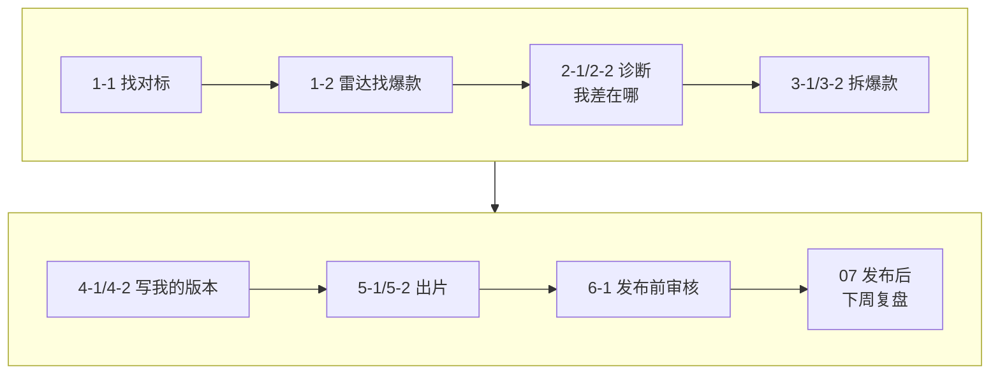

# 00 总纲：用 AI 跑通一个自媒体账号

这门课教你在 WorkBuddy 里用开源技能，把自己的账号从头跑一遍：找对标、做诊断、拆爆款、写自己的版本、出片、发布前审核。

每课只讲一个技能：先讲它怎么工作，再用你自己的账号跑出结果，最后教你核对。不用会编程，你用中文说清要什么，找资料、算数、出文件交给技能和 Agent。

| 项目 | 内容 |
| --- | --- |
| 难度 | 1 |
| 时长 | 10 分钟 |
| 前置 | 无 |
| 用到的工具 | 课程网站 |

## 课程地图

一个账号每周要做的事，大致就是下面这一圈：

| 模块 | 回答的问题 | 课程 | 主要技能 |
| --- | --- | --- | --- |
| 入门 | 技能怎么装、Key 怎么配 | 00、01 | WorkBuddy |
| ① 找对标 | 该学谁？他们这周什么作品真的爆了？ | 1-1、1-2 | social-account-doctor、benchmark-outlier-radar |
| ② 账号诊断 | 我的号差在哪？这条为什么不爆？ | 2-1、2-2 | social-account-doctor |
| ③ 视频拆解（逆向） | 爆款的画面、声音、钩子和结构是怎么做的？ | 3-1、3-2 | rea-video、social-account-doctor |
| ④ 爆款复刻 | 保留爆款的套路，换成我的内容 | 4-1、4-2 | social-account-doctor、Hypit |
| ⑤ 视频复刻 | 按拆解结果，把画面做出来 | 5-1、5-2 | MiniMax H3、HyperFrames、Capsule Cinema |
| ⑥ 违规审核 | 这条能不能发？被限流了怎么办？ | 6-1、6-2 | self-media-compliance-review |
| 结课 | 用自己的账号把一圈跑完，变成每周的习惯 | 07 | 全部 |

**建议顺序**：01 必须先学，装技能、配 Key 都在这一课。之后按模块顺序学最顺，前一课的结果就是后一课的输入。只想学某一课也行，把提示词里“上一课的结果”换成你手上已有的材料，比如没做 1-1，就直接告诉它你的 3 个对标账号。

### 两个“复刻”有什么不同

- **爆款复刻（④）**：学套路。钩子、结构、节奏不变，换成你自己的选题。
- **视频复刻（⑤）**：学做法。按逐镜拆解的结果，把镜头、花字、剪辑还原出来，但故事和人物换成你自己的。

## 每一课怎么学

每课的结构都一样：

| 部分 | 讲什么 |
| --- | --- |
| 它是怎么工作的 | 一张流程图 + 每一步一句话。弄懂原理，你才知道结果哪里可信、哪里要查 |
| 你要准备什么 | 你自己的主页链接、后台截图、想学的爆款视频，以及需要的 Key |
| 动手 | 1–3 条提示词。把 `<尖括号>` 换成你自己的东西再发 |
| 你会拿到什么 | 结果文件的结构，好结果长什么样 |
| 怎么核对结果 | 按技能自己的规则检查：数字有没有出处、有没有标完整度、拿不准的有没有标出来 |
| 常见问题、进阶与边界 | 搜不到、没 Key、数据拿不到怎么办；技能做不到什么 |

录屏里用的是演示账号“阿夏的AI片场”（做 AI 短片和 AI 视频工具教程，抖音为主）。它的后台数据是虚构的，两条“爆款样片”是课程自制的，人物都是 AI 原创角色。你学的时候用自己的账号，结果和录屏不一样是正常的，按“怎么核对结果”检查就行。

## 开始前准备什么

| 准备 | 用在哪 | 没有怎么办 |
| --- | --- | --- |
| 你的账号主页链接 | 1-1、2-1 | 还没起号：想好一句话，做什么内容、什么形式、给谁看 |
| 后台数据截图（作品数据、单条数据） | 2-1、2-2 | 新号可以先跳过，做完 1-1、1-2 再回来 |
| 1–2 条你想学的对标爆款视频 | 3-1、3-2、4-2 | 1-2 会帮你从对标里挑出来 |
| 一个空的工作文件夹 | 所有课 | 01 课带你建 |
| 多模态模型 Key | 1-1、2-1、2-2、3-2 | 01 课讲怎么配；没有它，“看图”的步骤做不了 |

## AI 视频生成的路线

需要“生成画面”的地方（4-2、5-1、5-2），有三种做法：

| 路线 | 怎么做 | 花多少钱 | 适合谁 |
| --- | --- | --- | --- |
| H3 · 自己租 GPU | 开源视频模型 MiniMax H3 部署在 AutoDL 上，Agent 自动开机、生成、下载、关机 | 只付 GPU 租金，10 秒 1080p 约 ¥0.3（以 AutoDL 实际计费为准） | 量大、想压成本、愿意折腾部署 |
| H3 · 直接调 API | 不部署，用 MiniMax 官方 API 或 RunningHub 按次生成 | 按次计费，历史参考价 5 秒 768p 约 ¥2.50，以平台当日价格为准 | 只偶尔出几条、不想管机器 |
| 代码视频 | 用 HyperFrames / Hypit 写网页动画再渲染成视频：排行榜、花字、标题卡、字幕 | 不需要 GPU，几乎不花钱 | 没有生成预算；教程、榜单、知识类内容 |

## 贯穿全课的核对习惯

- **数字要有出处**：倍数、粉丝、时间点，都要能在报告、后台截图或原片里找到。技能算数，AI 只解读。
- **看完整度**：技能缺了某一层（没搜到、没 Key、没看图）必须标出来，标了“部分”的结论只能当参考。
- **回原片看**：拆解报告说第几秒出现什么，拖到那一秒看一眼。
- **不照抄**：复刻学的是结构和做法，不是别人的台词、角色和水印。
- **不自动发布**：课程只做到“可以发布的作品包”，发不发由你决定。

## 下一课

01 入门：建好工作文件夹，装好技能，配好 Key，再用你自己的账号跑通第一个小任务。

## 本次任务结果与核对

录屏演示的是课程网站导览：课程地图、每课结构、开始前准备。

> 作者试跑结果待补：实际产物、发现的问题与修订、交付文件链接。

## 操作画面

截图待录制后补充。

[观看 00 实操录屏](../录屏/00-WorkBuddy实操.mp4) · [字幕](../录屏/00-WorkBuddy实操.vtt)
