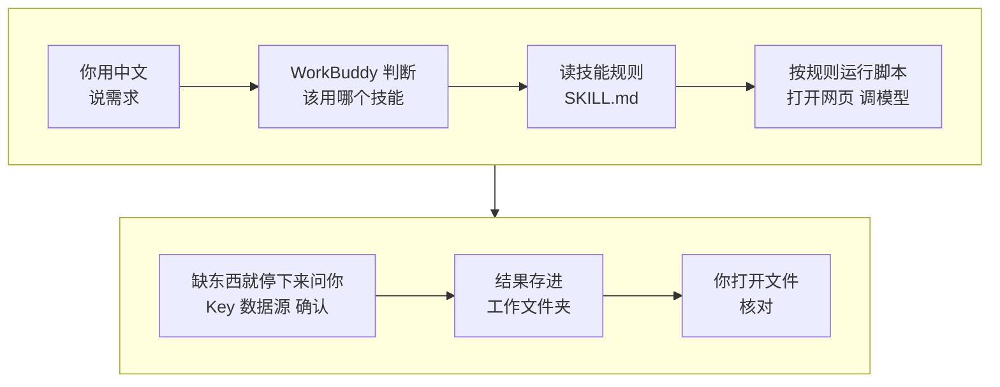

# 01 入门：装好技能，配好 Key

这一课把“干活的地方”准备好：建一个你自己的工作文件夹，检查电脑环境，装好本课程的技能，配好多模态 Key，确认 WorkBuddy 能打开平台网页，最后用你自己的账号跑通第一个技能任务。

| 项目 | 内容 |
| --- | --- |
| 难度 | 1 |
| 时长 | 40 分钟（含安装等待） |
| 前置 | 无 |
| 产出 | 环境检查表、已安装并开启的技能、配好的 Key、你的账号定位一句话 |
| 用到的工具 | WorkBuddy；social-account-doctor 及本课程其他技能 |

## 它是怎么工作的



1. **技能是一份写好的操作规则**，有的还带脚本。它规定某类任务怎么做：先读什么、怎么算、结果长什么样、哪些事不能做（比如不能编数字）。
2. **WorkBuddy 按需求挑技能**。你在提示词里点名“用 XX 技能”最稳。
3. **技能会运行脚本、打开网页、调用模型**。所以要装依赖（Python、ffmpeg 等），要配 Key（看图、看视频用的多模态模型）。
4. **缺东西时技能会停下来问你**：没 Key、平台页面读不出来、要花钱，都应该先问。没问就开始扣费的，停下来检查。
5. **结果存成文件**，放在你选的工作文件夹里。AI 说“已保存”不算数，你打开文件看过才算。

## 你要准备什么

| 准备 | 说明 |
| --- | --- |
| WorkBuddy | 从[官网](https://www.workbuddy.cn)下载并登录。使用会消耗积分，规则以应用内说明为准 |
| 一个空文件夹 | 比如桌面上的“我的自媒体工作台”。以后所有结果都存在这里 |
| 多模态模型 Key | 看封面、看视频、读截图用。推荐 Gemini 系列，用 OpenAI 兼容接口：需要 Key、接口地址、模型名三样 |
| 你的主页链接 | 第一个任务要用。还没起号就准备一句话：做什么内容、什么形式、给谁看 |

## 动手：装好环境，跑通第一个任务

### 第 1 步：选工作空间

1. 打开 WorkBuddy，点左上角“新建任务”。
2. 在输入框下方点“选择工作空间”，选“打开本地文件夹”，选中你建好的文件夹。
3. 输入框下方出现文件夹名，就选好了。以后每个任务都先看一眼这里。

### 实操 1：检查电脑环境

```text
帮我检查一下这台电脑的 Python、Node.js、ffmpeg 和 git 装没装、版本够不够（Python 要 3.10 以上，Node.js 要 22 以上）。列个表给我看，缺的先别装，告诉我怎么装就行。
```

| 工具 | 要求 | 谁要用 |
| --- | --- | --- |
| Python | 3.10 以上（Capsule Cinema 要 3.12） | 大部分技能的脚本 |
| Node.js | 22 以上 | Hypit、HyperFrames |
| ffmpeg | 较新版本 | 拆视频、剪视频、抽帧 |
| git | 任意版本 | 下载技能仓库 |

### 实操 2：安装 social-account-doctor 并配 Key

这是 1-1、2-1、2-2、3-2、4-1 都要用的技能，先装它。

```text
请帮我安装 social-account-doctor 技能，安装说明在：
https://raw.githubusercontent.com/JuneYaooo/social-account-doctor/main/docs/install.md
装之前先告诉我打算装到哪里，我确认后再装。需要填 API Key 时停下来，告诉我写到哪个文件的哪一行，我自己填，不要在对话里显示任何 Key。
```

它说明安装目录后，看一眼路径合理，回复“确认，就装到这个目录”。

到要填 Key 时，**自己打开它说的那个文件**（技能目录里的 `.env`）填这三行，保存：

| 变量 | 填什么 |
| --- | --- |
| `VIDEO_ANALYSIS_API_KEY` | 你的多模态模型 Key |
| `VIDEO_ANALYSIS_BASE_URL` | 接口地址（OpenAI 兼容的 `/v1` 地址） |
| `VIDEO_ANALYSIS_MODEL_NAME` | 模型名 |

`TIKHUB_API_KEY`（付费平台数据接口）先不用填，第 3 步会告诉你什么时候需要它。

### 实操 3：确认 WorkBuddy 能打开平台网页

找对标、做体检都要上平台看页面。技能会优先用 WorkBuddy 自带的浏览器能力，先确认它能用：

```text
打开 <你的主页链接>，告诉我你能看到哪些信息：粉丝数、作品列表、每条作品的点赞评论收藏。看不到的说明原因，不要猜。
```

- **能看到**：后面的课直接用，不用额外花钱。
- **看不到或被要求登录**：记下来。到 1-1 时技能会给你两个选择：配 TikHub Key（按次付费），或者你手动给链接和截图。

### 实操 4：第一个技能任务：账号定位一句话

```text
用 social-account-doctor 看一下我的账号：<你的主页链接>。用一句话帮我写出账号定位：做什么内容、什么形式、给谁看、和同类比有什么不一样。数字和判断都要能在主页上找到，看不到的标出来。结果放到 成果/01。
```

这句定位在 4-1 写自己的版本时要用，先存好。

### 其他技能：学到对应模块时再装也行

| 工具 | 用在 | 装法 | 需要的 Key 或账号 |
| --- | --- | --- | --- |
| [benchmark-outlier-radar](https://github.com/JuneYaooo/benchmark-outlier-radar) | 1-2、07 | GitHub 页面点 Code → Download ZIP，在 WorkBuddy“技能”页“上传技能” | 不需要，纯本地脚本 |
| [rea-video](https://github.com/JuneYaooo/rea-video) | 3-1 | 对 WorkBuddy 说“安装 https://github.com/JuneYaooo/rea-video ” | 可选：能看视频的模型 Key，不配也能用 |
| [Hypit](https://github.com/hypit-ai/hypit) | 4-2 | 终端运行 `npx skills add hypit-ai/hypit -g` | 代码视频路线不需要 |
| [open-source-video-gen-skill](https://github.com/mini-yifan/open-source-video-gen-skill) | 5-1 | 让 WorkBuddy 克隆仓库，导入 `minimax-h3`、`h3-prompt-writing`、`autodl-app-instance` | AutoDL 账号和 Token（自己租 GPU 时） |
| [Capsule Cinema](https://github.com/JuneYaooo/cheap-claude-video) | 5-1、5-2 | 让 WorkBuddy 按 [安装说明](https://raw.githubusercontent.com/JuneYaooo/cheap-claude-video/main/docs/install.md) 装（要 Python 3.12） | 直接调 H3 API 时：MiniMax 或 RunningHub 的 Key |
| [HyperFrames](https://github.com/heygen-com/hyperframes) | 5-2 | 终端运行 `npx hyperframes skills update` | 不需要 |
| [self-media-compliance-review](https://github.com/JuneYaooo/self-media-compliance-review) | 6-1、6-2 | Download ZIP 后上传，或让 WorkBuddy 按 README 装 | 不需要，默认不联网 |

装法有两种：**界面上传 ZIP**，适合纯规则、没有额外依赖的技能；**把安装说明链接发给 WorkBuddy 让它自己装**，适合要装依赖、要配 Key 的技能。装完都到“专家·技能·连接器”→“技能”→“已安装”里确认开关开着。

> 以试跑为准：social-account-doctor 和 self-media-compliance-review 的说明里写了支持 WorkBuddy；其余工具只写了 Claude Code、Codex 等。用命令装的技能如果在“已安装”里看不到，先重启 WorkBuddy；还看不到，让它把技能文件夹打包成 zip，用“上传技能”导入。

## 你会拿到什么

| 结果 | 在哪看 |
| --- | --- |
| 环境检查表 | 对话回复里，每项有实际版本号 |
| 已安装的技能 | “技能”→“已安装”列表，开关打开 |
| 配好的 Key | 技能目录里的 `.env`，只有你自己看过 |
| 浏览器能力结论 | 能不能打开平台页面、能看到哪些字段 |
| 账号定位一句话 | 工作文件夹的 `成果/01` 里 |

录屏里演示账号“阿夏的AI片场”的结果见下方截图。

## 怎么核对结果

- [ ] **版本号是真的**：环境表每一行都有实际版本号。只说“已安装”没给版本的，让它把命令输出贴出来。
- [ ] **技能真的装上了**：在“已安装”列表里看到，开关打开，而不是只听 AI 说“装好了”。
- [ ] **Key 没进对话**：翻一遍对话记录，没有出现 Key 的明文。
- [ ] **网页结论是看到的**：它说能看到的字段，你自己打开同一个页面对一下。
- [ ] **定位有依据**：定位里的每个判断，能在你的主页上找到对应的作品或简介；它标了“看不到”的地方，自己补上。
- [ ] **文件真的存在**：打开电脑上的工作文件夹，`成果/01` 里有这个文件。

## 常见问题

**提交后没看到文件？** 先看输入框下方的工作空间对不对，再到电脑上打开文件夹确认。

**装技能时 Agent 想把 Key 打印出来？** 让它停下，改成告诉你写到哪个文件，你自己填。

**Key 填好了，它还说没配？** 多半是改的不是它实际读取的那个 `.env`，或者 WorkBuddy 还没重启。让它告诉你它读的是哪个文件。

**多模态 Key 一定要配吗？** 找对标、体检、拆爆款都要“看图”，不配只能拿到“初步判断”。建议配上。

## 进阶与边界

- **安全**：Key、Token、Cookie 只写进本机配置文件，不贴进对话、不截图发人。装第三方技能前看一眼它会运行什么脚本、会不会联网或花钱。
- **写提示词的四个要素**：用什么技能、要什么结果、有什么要求、放到哪。不用写文件路径、文件名和命令，那是技能和 Agent 的事。
- **去哪找更多技能**：[awesome-ai-media-skills-cn](https://github.com/JuneYaooo/awesome-ai-media-skills-cn) 整理了 AI 视频和自媒体方向的技能、MCP 服务器和工具；[awesome-ai-media-cn](https://github.com/JuneYaooo/awesome-ai-media-cn) 收录了 150 多个开源项目。

## 下一课

1-1 用 AI 全网找对标：给出你的主页链接，让 social-account-doctor 去平台上实搜，筛出真正值得学的对标。

## 本次任务结果与核对

录屏演示的是从空文件夹开始装好技能、配好 Key（镜头外填写），并用演示账号“阿夏的AI片场”的资料跑通账号定位。

> 作者试跑结果待补：实际产物、发现的问题与修订、交付文件链接。

## 操作画面

截图待录制后补充。

[观看 01 实操录屏](../录屏/01-WorkBuddy实操.mp4) · [字幕](../录屏/01-WorkBuddy实操.vtt)
