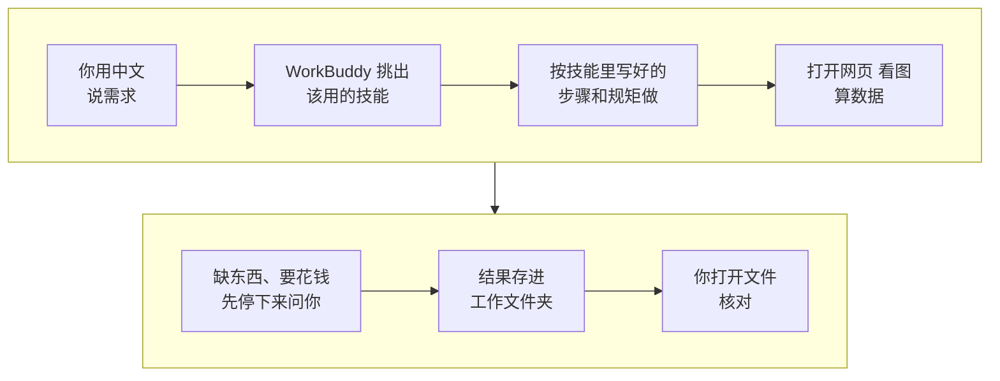

# 01 入门：装好 AI 助手，拿到第一个结果

AI 工具一大堆，不知道从哪下手？这一课只做四件事：建一个工作文件夹，申请一个会看图的模型 Key，装好全课用得最多的 social-account-doctor，然后让它看你的主页，用一句话写出你的账号定位。

整个过程不用打开终端，也不用写代码，装东西都交给 WorkBuddy。其他技能等学到对应那课再装。

| 项目 | 内容 |
| --- | --- |
| 难度 | 1 |
| 时长 | 30 分钟（含申请 Key 和安装等待） |
| 前置 | 无 |
| 产出 | 装好的 social-account-doctor、配好的看图 Key、WorkBuddy 能不能打开平台网页的结论、你的账号定位一句话 |
| 用到的工具 | WorkBuddy；social-account-doctor |

## 它是怎么工作的



可以把 WorkBuddy 想成一个助理，把技能想成交给助理的一本操作手册。

1. **技能是一本写好的操作手册**：某类活儿怎么干、先看什么、结果长什么样、哪些事不能做（比如不能编数字），都写在里面。
2. **WorkBuddy 按你的需求挑手册**。想让它别挑错，就在提示词里直接说“用 XX 技能”。
3. **技能会动手**：打开平台网页、看封面和视频、算数据。“看图”要靠一个会看图的模型，所以要先配一个 Key。
4. **缺东西会先问你**：没 Key、网页打不开、要花钱，都应该先停下来问。要是它没问就开始扣费，马上叫停。
5. **结果存成文件**，放在你选的工作文件夹里。AI 说“已保存”不算数，你自己打开看过才算。

::: 想知道细节：技能里到底有什么
一个技能就是一个文件夹，里面有一份规则说明（`SKILL.md`），有的还带几个小脚本。WorkBuddy 读规则，按规则调用脚本。所以有的技能需要电脑上有 Python、Node.js、ffmpeg 这类运行环境：装技能时 WorkBuddy 会自己检查，缺了会先告诉你，你同意后它再装。
:::

## 你要准备什么

| 准备 | 说明 |
| --- | --- |
| WorkBuddy | 从[官网](https://www.workbuddy.cn)下载 Windows 或 Mac 版并登录。用起来会扣积分，规则看应用内说明 |
| 一个空文件夹 | 比如桌面上的“我的自媒体工作台”。以后所有结果都存在这里 |
| 一个会看图的模型 Key | 看封面、看视频、读后台截图都靠它。实操 1 教你申请，按用量付费 |
| 你的主页链接 | 第一个任务要用。还没起号就准备一句话：做什么内容、什么形式、给谁看 |

## 动手：装好环境，跑通第一个任务

### 第 1 步：选工作空间

1. 打开 WorkBuddy，点左上角“新建任务”。
2. 在输入框下方点“选择工作空间”，选“打开本地文件夹”，选中你建好的文件夹。
3. 输入框下方出现文件夹名，就选好了。以后每个任务都先看一眼这里。

### 实操 1：申请一个会看图的模型 Key

Key 就是一串密码，让技能能用你的账户去调用模型、按用量扣费。你需要从平台上拿到三样东西，先记在自己的备忘录里，别发给任何人：

- **Key**：一长串字母数字；
- **接口地址**：一个网址；
- **模型名**：要用哪个模型。

两条路选一条：

| 路线 | 适合谁 | 接口地址 | 模型名 |
| --- | --- | --- | --- |
| 国内平台（如[硅基流动](https://cloud.siliconflow.cn)） | 不方便访问国外网站 | `https://api.siliconflow.cn/v1` | 在“模型广场”筛选“视觉”，选一个 Qwen-VL 系列模型，复制它的名字 |
| Gemini | 能访问 Google，想要更好的看视频效果（技能作者推荐） | `https://generativelanguage.googleapis.com/v1beta/openai` | 按 Google AI Studio 里显示的模型名填 |

以硅基流动为例：注册并实名，充一点钱，在左侧“API 密钥”里新建一个，复制保存。

技能作者主要用 Gemini 测试，换国内模型后看视频的效果以你自己试跑为准。国内模型如果不能直接看视频，技能会改成抽几张关键帧来看，下一步会多填一行设置。

### 实操 2：安装 social-account-doctor 并填 Key

这是 1-1、2-1、2-2、3-2、4-1 都要用的技能，先装它。

```text
请帮我安装 social-account-doctor 技能，安装说明在：
https://raw.githubusercontent.com/JuneYaooo/social-account-doctor/main/docs/install.md
装之前先告诉我打算装到哪里，我确认后再装。需要填 API Key 时停下来，告诉我写到哪个文件的哪一行，我自己填，不要在对话里显示任何 Key。
```

它报出安装目录后，你看一眼没问题，就回复“确认，就装到这个目录”。装的过程中缺什么（比如 Python），它会先告诉你，你同意了它再装。

到要填 Key 时，**自己打开它说的那个文件**（技能文件夹里的 `.env`，用记事本或文本编辑器打开就行），找到下面三行，把等号后面换成你在实操 1 拿到的东西，保存：

| 这一行 | 填什么 |
| --- | --- |
| `VIDEO_ANALYSIS_API_KEY` | 你的 Key |
| `VIDEO_ANALYSIS_BASE_URL` | 接口地址 |
| `VIDEO_ANALYSIS_MODEL_NAME` | 模型名 |

用国内模型的，再加一行 `VIDEO_ANALYSIS_USE_VIDEO_URL=0`，意思是看视频时改成抽关键帧看。`TIKHUB_API_KEY`（付费的平台数据接口）先空着，实操 3 会告诉你什么时候需要它。

填好后回到 WorkBuddy 说“Key 填好了，继续装完，检查一下能不能用”。最后到“专家·技能·连接器”→“技能”→“已安装”里，确认它在列表里、开关开着。

### 实操 3：确认 WorkBuddy 能打开平台网页

找对标、做体检都要上平台看页面。技能优先用 WorkBuddy 自带的浏览器能力，先试试它能不能用：

```text
打开 <你的主页链接>，告诉我你能看到哪些信息：粉丝数、作品列表、每条作品的点赞评论收藏。看不到的说明原因，不要猜。
```

- **能看到**：后面的课直接用，不用额外花钱。
- **看不到或被要求登录**：记下来。到 1-1 时技能会给你两个选择：配 TikHub Key（按次付费），或者你手动给链接和截图。

### 实操 4：第一个技能任务：账号定位一句话

```text
用 social-account-doctor 看一下我的账号：<你的主页链接>。用一句话帮我写出账号定位：做什么内容、什么形式、给谁看、和同类比有什么不一样。数字和判断都要能在主页上找到，看不到的标出来。结果放到 成果/01。
```

这句定位在 4-1 写自己的版本时要用，先存好。

### 其他技能：学到那一课再装

每课的“你要准备什么”里都有一条安装提示词，到时候发给 WorkBuddy 就行。

| 技能 | 哪一课装 | 帮你干什么 |
| --- | --- | --- |
| benchmark-outlier-radar | 1-2 | 算出对标每条作品是它平时的几倍，找出真爆款 |
| rea-video | 3-1 | 逐镜拆一条视频：每一镜怎么拍、怎么做的 |
| Hypit | 4-2 | 把一条爆款做成模板，换内容批量出变体 |
| open-source-video-gen-skill、Capsule Cinema | 5-1（选学） | 用 AI 生成镜头 |
| HyperFrames | 5-2（选学） | 做花字、标题卡 |
| self-media-compliance-review | 6-1 | 发布前审核、限流排查 |

::: 想知道细节：各技能需要的运行环境和装法
| 技能 | 运行环境 | 需要的 Key 或账号 |
| --- | --- | --- |
| [benchmark-outlier-radar](https://github.com/JuneYaooo/benchmark-outlier-radar) | Python 3.10+ | 不需要，纯本地脚本 |
| [rea-video](https://github.com/JuneYaooo/rea-video) | Python 3.10+、ffmpeg | 可选：能看视频的模型 Key，不配也能用 |
| [Hypit](https://github.com/hypit-ai/hypit) | Node.js 22+ | 代码视频路线不需要 |
| [open-source-video-gen-skill](https://github.com/mini-yifan/open-source-video-gen-skill) | Python | AutoDL 账号和 Token（自己租 GPU 时） |
| [Capsule Cinema](https://github.com/JuneYaooo/cheap-claude-video) | Python 3.12 | 直接调 H3 API 时：MiniMax 或 RunningHub 的 Key |
| [HyperFrames](https://github.com/heygen-com/hyperframes) | Node.js 22+、ffmpeg | 不需要 |
| [self-media-compliance-review](https://github.com/JuneYaooo/self-media-compliance-review) | Python | 不需要，默认不联网 |

纯规则、没有额外依赖的技能，也可以在 GitHub 页面点 Code → Download ZIP，到 WorkBuddy“技能”页点“上传技能”。

以试跑为准：social-account-doctor 和 self-media-compliance-review 的说明里写了支持 WorkBuddy，其余工具只写了 Claude Code、Codex 等。装好后在“已安装”里看不到，先重启 WorkBuddy；还看不到，让它把技能文件夹打包成 zip，用“上传技能”导入。
:::

## 你会拿到什么

| 结果 | 在哪看 |
| --- | --- |
| 已安装的技能 | “技能”→“已安装”列表，开关打开 |
| 配好的 Key | 技能文件夹里的 `.env`，只有你自己看过 |
| 浏览器能力结论 | 能不能打开平台页面、能看到哪些数字 |
| 账号定位一句话 | 工作文件夹的 `成果/01` 里 |

录屏里演示账号“阿夏的AI片场”的结果见下方截图。

## 怎么核对结果

- [ ] **技能装上了**：在“已安装”列表里能看到，开关是开的。别只听 AI 说“装好了”。
- [ ] **Key 没进对话**：翻一遍对话记录，没有出现 Key 的明文。
- [ ] **网页结论是看到的**：它说能看到哪些数字，你自己打开同一个页面对一下。
- [ ] **定位有依据**：定位里的每个判断，能在你的主页上找到对应的作品或简介；它标了“看不到”的地方，自己补上。
- [ ] **文件确实存在**：打开电脑上的工作文件夹，`成果/01` 里有这个文件。

## 常见问题

**提交后没看到文件？** 先看输入框下方的工作空间对不对，再到电脑上打开文件夹确认。

**装技能时 Agent 想把 Key 打印出来？** 让它停下，改成告诉你写到哪个文件，你自己填。

**Key 填好了，它还说没配？** 多半是改的不是它实际读取的那个 `.env`，或者 WorkBuddy 还没重启。让它告诉你它读的是哪个文件。

**看图 Key 一定要配吗？** 找对标、体检、拆爆款都要“看图”，不配的话只能拿到“初步判断”，建议配上。

**它说缺 Python，要我装？** 让它先说明要装什么、装到哪，你同意后它来装。不用自己去官网下载。

## 进阶与边界

- **安全**：Key、Token、Cookie 只写进本机配置文件，不贴进对话、不截图发人。装第三方技能前，让它先说清会运行什么、会不会联网或花钱。
- **写提示词的四个要素**：用什么技能、要什么结果、有什么要求、放到哪。不用写文件路径、文件名和命令，那是技能和 Agent 的事。
- **去哪找更多技能**：[awesome-ai-media-skills-cn](https://github.com/JuneYaooo/awesome-ai-media-skills-cn) 整理了 AI 视频和自媒体方向的技能、MCP 服务器和工具；[awesome-ai-media-cn](https://github.com/JuneYaooo/awesome-ai-media-cn) 收录了 150 多个开源项目。

## 下一课

1-1 用 AI 全网找对标：给出你的主页链接，让 social-account-doctor 去平台上实搜，筛出值得学的对标。

## 本次任务结果与核对

录屏演示的是从空文件夹开始装好技能、配好 Key（镜头外填写），并用演示账号“阿夏的AI片场”的资料跑通账号定位。

> 作者试跑结果待补：实际产物、发现的问题与修订、交付文件链接。

## 操作画面

截图待录制后补充。

[观看 01 实操录屏](../录屏/01-WorkBuddy实操.mp4) · [字幕](../录屏/01-WorkBuddy实操.vtt)
