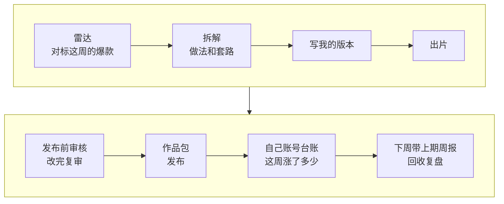

# 07 结课：用你自己的账号跑一遍，变成每周循环

这一课不学新技能。你用自己的账号，把前面六个模块串成一条链路跑一遍：雷达找对标这周的爆款 → 拆解 → 写你的版本 → 出片 → 发布前审核，交付一个能直接发布的作品包。再用 benchmark-outlier-radar 的“台账”和“回收上期”，把它变成每周固定做一次的复盘。

| 项目 | 内容 |
| --- | --- |
| 难度 | 3 |
| 时长 | 60 分钟（第一次）；之后每周约 30 分钟 |
| 前置 | 1-1 到 6-1 至少学过一遍；有自己选好的 3–5 个对标 |
| 产出 | 你自己的作品包（成片、标题封面、发布文案、审核报告、来源说明）；本周复盘；自己账号的数据台账 |
| 用到的工具 | benchmark-outlier-radar、social-account-doctor、rea-video、Hypit / HyperFrames、self-media-compliance-review |

## 它是怎么工作的



1. **雷达**：整理对标最近 20 条作品的数据，跑 benchmark-outlier-radar，找出这周倍数异常的作品（1-2）。
2. **拆解**：对选中的爆款，用 rea-video 看懂画面怎么做（3-1），用 social-account-doctor 拆钩子和结构（3-2）。两样不一定都做，学画面就拆镜头，学套路就拆钩子。
3. **写我的版本**：用 social-account-doctor 的仿写，按爆款的结构写你自己的选题（4-1）。
4. **出片**：结构和上次一样，就复用你在 4-2 / 5-2 存下的工作流和配方，只换内容；换了新做法才从头做。
5. **发布前审核**：成片和文案一起审，有 High 或 Blocker 先改再复审（6-1）。
6. **作品包**：成片、标题封面、发布文案、审核报告放在一起，附一份说明，写清每个文件来自哪一步。
7. **自己账号台账**：每周导出一次自己的作品数据，雷达的台账功能会算出每条作品这一期新增了多少；有 3 期以上，才算周环比。
8. **回收上期**：下周跑雷达时，把上周的周报一起给它，它会逐条标出上周的建议哪些被验证、哪些落空，再调整这周的建议。

## 你要准备什么

| 准备 | 说明 |
| --- | --- |
| 3–5 个对标 | 1-1 选出的；对标停更或转型了，就重新跑一次 1-1 |
| 对标最近 20 条作品的数据 | 让 AI 用浏览器整理公开的点赞、评论、收藏（1-2 的做法） |
| 自己账号的作品数据 | 从创作者中心导出，每周同一天导一次，每次的文件都留着 |
| 上周的周报 | 第一次做没有，从第二周开始带上 |
| 上次的工作流和配方 | 4-2、5-2 存下的。没有就按对应课从头做 |

## 动手：用你自己的账号跑一遍

这几条提示词最好在同一个任务里依次发，AI 能直接用上一步的结果。

### 实操 1：雷达找本周爆款

```text
这是我 3 个对标 <账号A>、<账号B>、<账号C> 的主页。帮我整理它们最近 20 条作品的公开点赞、评论、收藏，再用 benchmark-outlier-radar 生成本周雷达周报，以 <今天的日期> 为基准。<有上周周报就加：上周的周报也在文件夹里，逐条看看上周的判断哪些被验证了、哪些落空了。> 选 1 条最值得做的，说明要学的是内容套路还是画面做法；互动率异常的先标“待核对”，不要选。这一课的结果都放到 成果/07。
```

### 实操 2：拆解并写我的版本

```text
拆一下刚选的这条：<学套路就写“用 social-account-doctor 拆钩子和结构”；学画面就写“用 rea-video 逐镜拆解，视频文件在文件夹里”>。然后按它的结构，用我的定位写下一条：我的账号是 <一句话定位>，这次想发 <你的选题>。给 3 个标题、3 个封面大字和完整脚本，不照抄原句，不夸大、不承诺收益、不留联系方式。
```

### 实操 3：出片

```text
用 <Hypit / HyperFrames> 复用我上次存的 <工作流或配方名>，只把内容换成刚写的脚本，版式和动效不变。<是 AI 生成的就加：开头加“AI 生成”提示。> 出片后逐字核对字幕和配音是否一致。
```

### 实操 4：审核并打包

```text
用 self-media-compliance-review 审这条成片和发布文案，目标平台 <平台>。有 High 或 Blocker 就先改再复审，不要打包。全部降到 Low 或 Pass 后，把成片、选定的标题和封面大字、发布文案、审核报告放成一个作品包，再写一份说明，列出每个文件来自哪一步。
```

### 实操 5：自己账号的台账

```text
这是我账号最近几期导出的作品数据，用 benchmark-outlier-radar 帮我做一份台账：每条作品这一期新增了多少，哪些在涨、哪些停了。再和对标雷达放在一起，写一份本周复盘：本周做了什么、数据怎么样、下周做什么。复盘做成模板，下周我直接填。
```

## 你会拿到什么

| 产物 | 内容 |
| --- | --- |
| 雷达周报 | 对标异常爆款表（倍数、档位、置信、⚠️），本周选题；从第二周起多一段“上期回收” |
| 拆解与脚本 | 选中爆款的拆解；你的标题、封面大字、脚本 |
| 成片 | 用你的内容做出的视频 |
| 审核报告 | 结论等级和复审结果 |
| 作品包 + 说明 | 每个文件从哪一步来，出了问题能顺着找回去 |
| 台账与周复盘 | 自己账号每期新增、涨跌标记；下周可以直接填的复盘模板 |

录屏里演示账号“阿夏的AI片场”走完整条链路的过程见下方截图。

## 怎么核对结果

- [ ] **雷达的数字只来自周报**：解读和选题理由里引用的倍数、点赞数，在周报里都能找到原数。
- [ ] **选题没选 ⚠️ 的**：互动率异常的条目先核对，不当选题。
- [ ] **每一步用的是上一步的结果**：脚本里的结构对得上拆解，出片用的是这次的脚本，审核的是这次的成片。
- [ ] **审核过了才打包**：作品包里的审核报告结论是 Low 或 Pass；有改动的，有复审记录。
- [ ] **台账口径一致**：几期数据要来自同一个导出位置，日期写清楚；只有一期数据时，它不应该给出“涨了多少”。
- [ ] **上期回收说实话**：上周的建议没被验证的，它应该写“落空”，而不是换个说法圆回来。

## 常见问题

**每周都要从 1-1 开始吗？** 不用。对标 1–2 个月重找一次；每周固定做的是雷达、选一条、做一条、审一条。

**这周雷达没找到异常爆款？** 很正常。这周就做你自己的选题，或者翻翻台账，挑自己涨得好的那条做续集。

**导出的数据和雷达要的格式不一样？** 直接把导出文件给它，让它按雷达要求的列整理。看不到的指标留空，不要填 0。

**能不能每周自动跑？** 可以接第三方数据接口加定时任务，但要付费、要授权，还有平台规则的风险。建议先手动跑几周，确认这套流程对你有用再说。

## 进阶与边界

- **雷达只是信号**：倍数高只说明这条比它自己的常态好得多，不代表照着做一定爆。原因一律写成假设。
- **台账要攒期数**：两期能算新增，三期以上才有周环比。
- **复刻只学做法**：拆解是为了学方法，不要搬运原片；用到 AI 生成、真人素材和音乐时，发布前都过一遍 6-1。

## 本次任务结果与核对

录屏演示用“阿夏的AI片场”在 1-2 之后一周重新整理同一批对标的数据，带上 1-2 的周报复盘，再把整条链路走到作品包。

> 作者试跑结果待补：实际产物、发现的问题与修订、交付文件链接。

## 操作画面

截图待录制后补充。

[观看 07 实操录屏](../录屏/07-WorkBuddy实操.mp4) · [字幕](../录屏/07-WorkBuddy实操.vtt)
