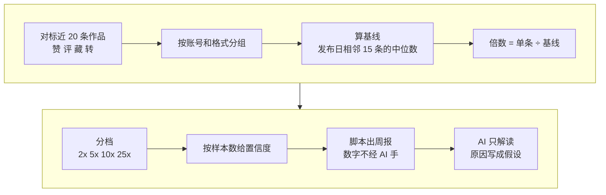

# 1-2 对标爆款雷达：找出对标这周真正爆的那条

这一课用 benchmark-outlier-radar，拿 1-1 选出的对标，算出每条作品是它自己平时水平的几倍，找出这周“爆了”的那一条，留给后面拆。

对标账号每周都在发新作品，光看点赞数比不出高低：4 万粉的号拿 5 千赞，和 50 万粉的号拿 5 千赞，是两回事。所以这个技能不比绝对数字，只看“这条是它平时的几倍”。

| 项目 | 内容 |
| --- | --- |
| 难度 | 1 |
| 时长 | 25 分钟（其中 Agent 整理数据约 10 分钟） |
| 前置 | 1-1（你选定的 3–5 个对标） |
| 产出 | 对标数据表、雷达周报（倍数、档位、置信度）、本周最值得拆的一条 |
| 用到的工具 | benchmark-outlier-radar |

## 它是怎么工作的



1. **数据**：每个对标账号最近 15–20 条作品，每条要有发布日期和互动数。技能本身不上网、不爬数据，得先把数据整理好交给它。
2. **分组**：同一个账号的短视频和长视频分开算，混在一起会互相拉偏。
3. **基线**：每算一条作品，就取同账号、同格式里发布日期离它最近的 15 条，算中位数。这一条本身不算在内，发布不满 3 天、数据还没跑完的也不算。用中位数不用均值，是因为一两条爆款就能把均值拉高。
4. **倍数**：这条的互动数 ÷ 基线。
5. **分档**：2–5 倍 👀 观察；5 倍以上 ✅；10 倍以上 🔥；25 倍以上 🔥 25x+，先核对基线是不是被几条特别低的拉低了。
6. **置信度**：基线样本少于 3 条不算倍数；3–4 条为低，5–9 条为中，10 条以上为高。
7. **周报**：倍数全由脚本算，AI 只负责解读。原因写成假设，只引用周报里的数字，下周建议最多给 3 条。

**为什么用“互动”而不是“播放”**：抖音、小红书上看不到别人作品的播放量，只能看到赞、评、藏、转，所以对标用“互动倍数”（四项相加，看不到的留空）。播放量只在你自己的后台看得到。

## 你要准备什么

| 准备 | 说明 |
| --- | --- |
| 1-1 选定的对标 | 3–5 个账号。没做 1-1，直接告诉它你的对标账号名或主页链接 |
| 浏览器能力 | 01 课确认过 WorkBuddy 能打开平台页面。Agent 用它去读对标主页，整理数据 |
| 不需要 Key | 雷达是纯本地脚本，不联网、不花钱 |

## 动手：给你的对标跑一次雷达

### 实操 1：整理对标数据

```text
打开 <1-1 选定的对标> 这几个账号的主页，把每个账号最近 20 条作品整理成一张表：标题、发布日期、点赞、评论、收藏、转发。页面上看不到的数留空，不要填 0，也不要估。整理完先给我看一眼，放到 成果/1-2。
```

整理完先自己点开一两条作品，对一下数字。数据错了，后面的倍数全错。

### 实操 2：跑雷达，挑出本周最值得拆的一条

```text
用 benchmark-outlier-radar 对这几个对标跑一次雷达，以今天为基准，用互动数算倍数，出一份周报。解读时只引用周报里的数字，原因写成假设。最后结合我的账号定位，选出本周最值得拆的一条，说清要学的是内容套路还是画面做法。
```

## 你会拿到什么

| 部分 | 内容 |
| --- | --- |
| 对标数据表 | 每个账号近 20 条作品的发布日期和赞评藏转 |
| 周报：异常条目 | 账号、作品、互动数、基线（样本数）、倍数、档位、置信度 |
| 周报：说明 | 基准日、用的指标、哪些行因为数据缺失没算 |
| 解读 | 每条异常作品的可能原因（选题、标题、封面、发布时间），写成假设 |
| 本周待拆 | 最值得拆的一条，以及学套路还是学画面 |

录屏里演示账号“阿夏的AI片场”的对标是 1-1 实搜到的真实账号，结果见下方截图。你的对标不同，结果也不同。

## 怎么核对结果

- [ ] **数据是读出来的**：随机点开 2–3 条作品，赞评藏转和表里一致；看不到的是空着，不是 0。
- [ ] **数字没改过**：解读里引用的倍数、互动数，在周报表格里能逐字找到。AI 转述时常会四舍五入或记错。
- [ ] **看置信度**：置信“低”的条目参考意义有限，别当爆款拆。
- [ ] **25 倍以上先核对**：打开那个账号，看它平时是不是有很多条特别低的作品把基线拉低了。
- [ ] **观察档不是爆款**：2–5 倍只是“值得留意”。
- [ ] **原因是假设**：写的是“可能因为……”，不是“照着做一定爆”。
- [ ] **选的这条和你相关**：倍数再高，题材和你的账号不沾边，也没有参考价值。

## 常见问题

**它说读不出主页上的数据？** 平台页面经常改版。可以换个时间再试，或者自己打开几个对标主页，把作品列表截图发给它，让它从截图里整理。

**作品太少，很多条没算倍数？** 基线至少要 3 条同格式作品。新号、更新慢的号，多整理一些历史作品。

**发布日期看不到？** 有些平台列表页只显示“3 天前”。让它点进作品详情页看具体日期。

**周报里没有 ⚠️？** ⚠️ 是“互动率异常”（互动 ÷ 播放），要有播放量才算。对标只有互动数，所以不会出现。跑你自己的账号数据时有播放量，才会出现：互动率低于账号自己中位互动率的 25% 就标 ⚠️，提醒你先核对数据。

**多久跑一次？** 每周固定一天跑一次，07 课会把它变成每周的习惯。

## 进阶与边界

- **自己账号的台账**：同一个技能还能给你自己的账号记周台账。每周从后台导出一次作品数据，按时间顺序交给它，它会算出每条作品这周新增了多少。攒满 3 期才有周环比。
- **YouTube**：频道有官方 RSS，不用 Key、数字精确，技能自带转换脚本。
- **批量采集工具**：[MediaCrawler](https://github.com/NanmiCoder/MediaCrawler) 可以批量采集公开作品数据。课程不演示：采得太快、太多容易被平台封号。确实要用，就用小号、少量、拉长间隔，只采公开数据自己研究。
- **它做不到的**：倍数只是筛选信号，不预测流量，也不解释平台算法。原始数据含账号经营信息，不要公开。

## 下一课

2-1 账号体检：把镜头转回你自己的账号，用 social-account-doctor 看清你和对标差在哪。

## 本次任务结果与核对

录屏演示的是用 1-1 实搜到的 3 个真实对标、由 Agent 读取公开主页整理数据后跑出的雷达，结果随录制日期变化。

> 作者试跑结果待补：实际产物、发现的问题与修订、交付文件链接。

## 操作画面

截图待录制后补充。

[观看 1-2 实操录屏](../录屏/1-2-WorkBuddy实操.mp4) · [字幕](../录屏/1-2-WorkBuddy实操.vtt)
