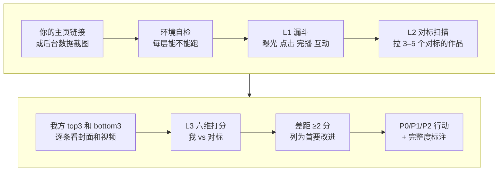

# 2-1 账号体检：用 AI 找出你的号差在哪

这一课用 social-account-doctor 的“诊断”模式，给你自己的账号做一次完整体检：先看流量卡在哪一层，再拿你的对标比一比，最后按六个维度打分，给出按优先级排好的改进动作。

你不需要自己算数据、做对比表。你只需要给出主页链接（或者后台导出的数据和截图），再告诉它你的对标是谁。

| 项目 | 内容 |
| --- | --- |
| 难度 | 2 |
| 时长 | 25 分钟（其中 AI 拉数据、看图约 10 分钟） |
| 前置 | 1-1（对标清单；没做也可以直接给 3–5 个对标账号） |
| 产出 | 账号诊断报告：漏斗判断、对标扫描、六维评分、P0/P1/P2 行动清单 |
| 用到的工具 | social-account-doctor（diagnostic 模式） |

## 它是怎么工作的



1. **环境自检**：动手前先检查三层各自要用的工具在不在：读截图要多模态 Key，拉对标作品要平台数据（浏览器或 TikHub）。哪一层跑不了，它必须在第一句话就告诉你，不能默默跳过。
2. **L1 漏斗**：看曝光、点击、完播、互动四个数，找出第一个跌破平台阈值的那一层。平台是一层一层放量的，哪层卡住就停推，所以先定位卡点，再谈怎么改。
3. **L2 对标扫描**：拉你的对标最近 30 条作品，算爆款率（互动 ≥ 该号平均 5 倍）和扑街率（≤ 0.3 倍），看它们在发什么选题。
4. **看样本**：你的号挑互动最高 3 条和最低 3 条，对标挑最好的几条，逐条用多模态模型看封面和视频。
5. **L3 六维打分**：账号定位、选题角度、封面公式、标题钩子、正文骨架、发布节奏，你和对标各打 1–5 分。差 2 分以上的维度，就是首要改进项。
6. **出行动清单**：P0（马上改）、P1、P2，分成“继续保持 / 从对标补齐 / 不要照抄”。同一个做法在你 2 条以上的好作品里都出现、差作品里没有，才算“已验证的公式”；只出现 1 次的只能叫“单条假设”。

如果你做的是 AI 视频、AI 插画或数字人口播，它会自动加一节“AI 视频表达差距”：首帧冲突、人物和场景是否连贯、字幕有没有压到安全区、模板感、时长撑不撑得住。

## 你要准备什么

| 准备 | 说明 |
| --- | --- |
| 你的主页链接 | 它会拉你最近 30 条作品的公开数据。没有链接时，用创作者中心导出的作品数据或后台截图代替 |
| 后台截图（可选） | 带曝光、点击率、完播率的那几页。公开页看不到这些数，有截图漏斗才判断得准 |
| 你的对标 | 1-1 留下的 3–5 个。没做 1-1，就直接写账号名或主页链接 |
| 多模态 Key | 01 课配好的。没有它，看封面、看视频这一步做不了，报告只能标“部分” |

## 动手：给你自己的账号体检

### 实操 1：完整体检

```text
用 social-account-doctor 给我的抖音账号做一次完整诊断。我的主页：<你的主页链接>，后台截图在 <截图所在的文件夹>。对标用 <1-1 留下的对标，或直接写 3–5 个账号名>。先告诉我哪几层能跑、哪几层跑不了，再开始。最后给我 P0/P1/P2 的改进动作，分成“继续保持 / 从对标补齐 / 不要照抄”。结果放到 成果/2-1。
```

### 实操 2：追问一个结论

报告里任何一条你拿不准的结论，都可以追问依据：

```text
你说我“<报告里的某条结论>”，依据是哪几条作品、哪些数字？这是在我 2 条以上的作品里都验证过的，还是只是单条假设？
```

## 你会拿到什么

一份账号诊断报告，结构大致是：

| 部分 | 内容 |
| --- | --- |
| 完整度标注 | 开头写明“完整”，或“部分诊断，缺 Layer X，原因：……” |
| TL;DR | 一两句话的结论：卡在哪、最该先改什么 |
| 漏斗自检 | 四个指标和平台阈值的对比，第一个掉下去的是哪一层 |
| 对标扫描 | 每个对标的爆款率、扑街率、选题分布、代表作品 |
| 六维拆解 | 一张你 vs 对标的打分表，差距 ≥2 的维度标出来 |
| 单条拆解 | 你的最好一条、最差一条、对标最好一条，配封面图 |
| 可重复公式 | 已验证的公式和单条假设分开写 |
| 行动清单 | P0/P1/P2，每条写清只改什么、下一条看哪个数验证 |

录屏里演示账号“阿夏的AI片场”的报告见下方截图。你的结论会完全不同。

## 怎么核对结果

这些规则来自技能自己的要求，照着查：

- [ ] **完整度**：开头有没有写清哪一层没跑？缺了 L2 对标扫描还说“你比对标差在……”，这个结论不能信。
- [ ] **先定位卡点**：行动清单的 P0 应该对着漏斗里第一个卡住的那一层。点击率卡住却让你先改定位，是本末倒置。
- [ ] **数字能回查**：报告里的播放、互动、比例，挑两三个回你的主页或后台对一下。
- [ ] **平均值陷阱**：一条爆款能把整类内容的平均值拉高。看到“某类内容平均是另一类的几倍”，问它中位数是多少。
- [ ] **公式 vs 假设**：只在 1 条作品里出现的做法，不能当成“账号公式”去改号。
- [ ] **看得到图**：封面、首帧的判断，报告里应该嵌了对应的图。没有图的视觉判断只能算口头评价。
- [ ] **不乱改号**：改简介、改定位、换人设这类建议，缺硬数据时它应该写“数据不足，暂不下结论”。

## 常见问题

**它说 L2 跑不了？** 说明它拿不到对标的作品数据。按它给的选项走：用 WorkBuddy 自带浏览器再试一次；有 TikHub Key 就用（付费，它会先问你）；或者你把对标的几条代表作品链接直接发给它。

**它没看我的后台数据？** 公开主页只有点赞、评论、收藏，看不到曝光和完播。把创作者中心的数据页截图给它，漏斗才算得准。

**多久体检一次？** 每月一次，或者连续几条数据明显下滑时。每次体检只挑 P0 改，改完看两三条再来。

## 进阶与边界

- **它做不到的**：粉丝画像只有星图收录的账号拿得到，普通账号它会写“画像数据不可得”；变现建议它只在看到主页挂载时才给。
- **阈值是经验值**：漏斗阈值来自行业经验（截至 2026 年），不是平台官方数字，平台调整后会变。
- **只想看一条为什么不爆**：用下一课的单条诊断，更快。

## 下一课

2-2 单条诊断：拿一条数据不好的作品，看它卡在漏斗的哪一层。

## 本次任务结果与核对

录屏演示用的是演示账号“阿夏的AI片场”的后台数据和账号资料，对标用 1-1 实搜留下的账号。

> 作者试跑结果待补：实际产物、发现的问题与修订、交付文件链接。

## 操作画面

截图待录制后补充。

[观看 2-1 实操录屏](../录屏/2-1-WorkBuddy实操.mp4) · [字幕](../录屏/2-1-WorkBuddy实操.vtt)
