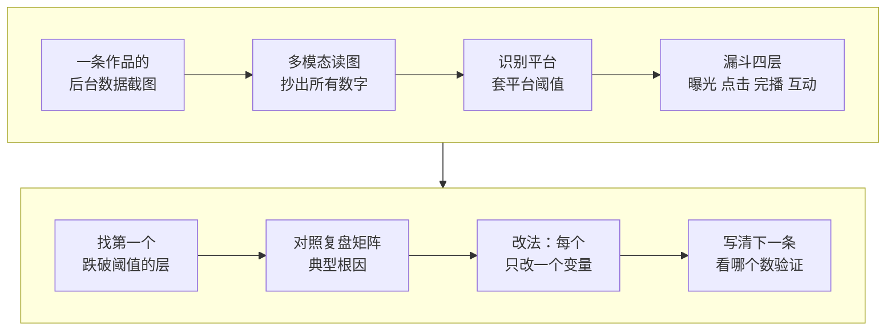

# 2-2 单条诊断：这条为什么不爆

这一课用 social-account-doctor 的诊断模式，只看一条作品。把这条的后台数据截图交给 AI，它会读出曝光、点击、完播、互动四个数，找出卡在漏斗的哪一层，再给出只改一个变量的改法。

不会看数据也没关系，截一张这条作品的后台数据页就够了。

| 项目 | 内容 |
| --- | --- |
| 难度 | 1 |
| 时长 | 15 分钟 |
| 前置 | 01（技能装好、多模态 Key 配好） |
| 产出 | 单条诊断：数字表、卡在哪一层、3 个只改一处的改法和验证指标 |
| 用到的工具 | social-account-doctor（diagnostic 模式，截图输入） |

## 它是怎么工作的



1. **读图抄数**：多模态模型读截图，把播放、点击率、跳出率、完播率、平均播放时长、互动数抄成表。看不清的就写“看不清”，不能猜。
2. **套平台阈值**：判断是哪个平台的后台，用这个平台的经验阈值。不知道平台时，它会先问你，或者只用通用阈值。
3. **漏斗定位**：曝光低是账号权重或标签问题；点击低是封面标题问题；完播低是开头钩子和结构问题；互动低是选题没打中或没埋互动点。只找第一个跌下去的那一层，后面的层先不管。
4. **对照根因**：技能内置一张“卡在哪 → 典型根因 → 改法”的复盘矩阵。比如 3–5 秒完播低，常见根因是开头没信息、自我介绍、首帧静止，改法是把最炸的画面提到第一秒。
5. **只改一个变量**：每个改法只动一处，并写清下一条看哪个数字来验证。一次改三处，下条好了也不知道是哪处起的作用。

## 你要准备什么

| 准备 | 说明 |
| --- | --- |
| 后台数据截图 | 这条作品在创作者中心的数据页，最好包含点击率、2 秒跳出率、5 秒完播率、完播率、平均播放时长 |
| 作品链接（可选） | 给了链接，它能顺便看封面、标题和评论，判断更准 |
| 多模态 Key | 01 课配好的。读截图要用它；没有时你可以把数字打字给它 |

## 动手：诊断你的一条作品

### 实操 1：找卡点

```text
用 social-account-doctor 帮我看看这条作品为什么不爆，后台截图是 <截图>，作品链接是 <链接，没有就删掉这句>。先把截图里的数字原样抄成一张表，看不清就写“看不清”，不要猜；再判断它卡在漏斗哪一层；最后给 3 个改法，每个只改一处，并写清下一条看哪个数字验证。结果放到 成果/2-2。
```

### 实操 2：数字不对时让它重抄

先拿报告的数字表和截图逐行对一遍。有抄错的，直接指出来：

```text
数字表有抄错：截图上 <指标> 是 <截图上的数>，不是 <报告里的数>。请对着截图重抄一遍，用到这几个数的判断都重算，并在报告末尾写一下改了什么。
```

## 你会拿到什么

| 部分 | 内容 |
| --- | --- |
| 完整度标注 | 只有截图、没有对标时，会写明是“仅 L1” |
| 数字表 | 截图里每个指标的原值 |
| 卡点判断 | 卡在曝光、点击、完播还是互动，依据是哪个数字跌破了阈值 |
| 根因 | 对照复盘矩阵给出的可能原因，写成假设 |
| 3 个改法 | 每个只改一处，配一个验证指标 |

录屏里演示账号“阿夏的AI片场”的一条作品诊断见下方截图。

## 怎么核对结果

- [ ] **数字表逐行对截图**：AI 读图最常见的错是两个相邻百分比对调、把“3.2 秒”读成“32 秒”。这一步不做，后面的判断全是错的。
- [ ] **卡点是第一个掉下去的层**：完播率 4% 很低，但如果 2 秒跳出率已经 60%，卡点其实在开头 2 秒。
- [ ] **原因有数字撑**：说“发布时间不对”，要有你不同时段发布的数据对比；没有这个对比，它就只是猜测，不能当主要原因。
- [ ] **改法只改一处**：每个改法写清改什么、看哪个数。“全面优化内容质量”这种不算改法。

## 常见问题

**截图读不出来？** 截图太小、太糊，或者是手机长截图。改成电脑端后台、只截数据那一块。实在读不了，就把几个数字直接打给它。

**它问我是哪个平台？** 不同平台的阈值不一样。告诉它是哪个平台，判断会准很多。

**数据都不错，就是播放少？** 那多半卡在第一层曝光，可能是账号标签乱了，或者被限流了。限流排查见 6-2。

## 进阶与边界

- **它做不到的**：看不到平台的推荐算法细节，阈值是行业经验值，不是官方数字。只给截图时，它不知道同赛道别人做得怎么样，想比对标就用 2-1 的完整体检。
- **一条数据说明不了规律**：单条诊断给的是假设。同样的问题在 2–3 条作品上都出现了，再当成账号问题去改。

## 下一课

3-1 逐镜拆解：看懂一条对标爆款的每个镜头是怎么做出来的。

## 本次任务结果与核对

录屏演示用的是演示账号“阿夏的AI片场”一条作品（赛博朋克重庆）的后台截图。

> 作者试跑结果待补：实际产物、发现的问题与修订、交付文件链接。

## 操作画面

截图待录制后补充。

[观看 2-2 实操录屏](../录屏/2-2-WorkBuddy实操.mp4) · [字幕](../录屏/2-2-WorkBuddy实操.vtt)
