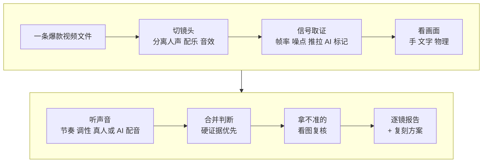

# 3-1 用 rea-video 看懂一条爆款是怎么做的

这一课用 rea-video 把一条对标爆款逐个镜头拆开：每一镜是实拍、AI 生成、代码动效还是录屏，花字什么时候出来，配音配乐从哪来。最后它会给你一份“照着做”的复刻方案，按实拍、AI 生成、代码分开写。

你不需要懂剪辑。你只需要一条想学的爆款视频文件。

| 项目 | 内容 |
| --- | --- |
| 难度 | 2 |
| 时长 | 30 分钟（其中拆解运行约 5–15 分钟） |
| 前置 | 01（技能装好）；最好有 1-2 选出的一条爆款 |
| 产出 | 一句话结论 + 逐镜拆解报告（含依据和置信度） + 复刻方案 |
| 用到的工具 | rea-video（看视频的模型可选） |

## 它是怎么工作的



1. **切镜头、分声音**：按画面变化切成一个个镜头，同时把人声、配乐、音效分开。
2. **信号取证**：从文件里找硬证据，比如帧率规律、噪点、整幅画面同步推拉、AI 生成的标记。实拍、AI、代码画面在这些信号上各有特点。
3. **看画面**：看手、文字、物理是否合理。比如字是一笔一笔打出来的、背景纯色无噪点，通常是代码动效。
4. **听声音**：测配乐的节奏（BPM）和调性，判断配音是真人还是 AI。
5. **合并判断**：硬证据优先，“看着像”排后面。每一镜给出结论、依据和置信度。
6. **看图复核**：置信度低的镜头，交给看视频的模型或 WorkBuddy 自己看图再判一次。
7. **出报告和方案**：一句话结论（比如“AI 视频 41% + 代码界面 59%”）、逐镜表、每个 AI 镜头反推的提示词，以及按实拍 / AI 生成 / 代码分开写的复刻方案。

## 你要准备什么

| 准备 | 说明 |
| --- | --- |
| 一条爆款视频文件 | rea-video 只读本地文件，不能直接打开链接。最好是 1-2 雷达选出来的那条 |
| ffmpeg、Python 3.10+ | 01 课的环境检查里已经确认过 |
| 看视频的模型（可选） | Gemini、豆包等都行，把接口和 Key 存进本机配置。不配也能用，WorkBuddy 能看图时会补看拿不准的镜头 |

**怎么拿到对标视频文件**：

1. **推荐**：平台 App 里能“保存到本地”的，直接保存，只用于个人学习拆解。
2. 把分享链接发给 WorkBuddy，让它试着解析下载。平台常改规则，失败了就回到第 1 种。
3. 开源工具 [Douyin_TikTok_Download_API](https://github.com/Evil0ctal/Douyin_TikTok_Download_API) 可以在自己电脑上部署，用分享链接下载无水印文件。课程不演示：需要自己配置，频繁调用有风险。确实要用，控制频率，只做个人学习。

不管哪种方式，拆解只为学做法：不搬运、不二次发布、不把原片画面剪进自己的作品。

**为什么最好用原始文件**：平台压缩过的视频会丢掉噪点这类证据。按 rea-video 自己的评测，只靠文件里的硬证据，原始文件的制作方式判断准确率在 98% 以上，转码压缩过的视频降到约 89%；让 Agent 对拿不准的镜头看图复核后，回到约 99%。所以拆平台视频时，一定要让它复核拿不准的镜头。

## 动手：拆你自己选的爆款

### 实操 1：拆解

```text
用 rea-video 拆一下这条爆款：<视频文件，或说“我放在工作文件夹里的那条”>。我想知道每一镜是实拍、AI 生成、代码动效还是录屏，判断依据和把握有多大；花字什么时候出现、什么样式；配音配乐从哪来。拿不准的镜头请看图复核，还是拿不准就标“待确认”并写清缺什么证据。给我一份中文逐镜报告，放到 成果/3-1。
```

### 实操 2：写复刻方案

```text
根据这份报告写一份复刻方案，我想做成自己的版本：<一句话说你的故事、人物或产品>。AI 镜头连在一起的尽量合并成一次生成，代码能做的花字和标题卡单独列出来，声音单独列。只学做法，不用原片的角色、台词和水印。
```

## 你会拿到什么

| 部分 | 内容 |
| --- | --- |
| 一句话结论 | 整条视频里各种做法占多少，配乐什么类型、多少 BPM |
| 分镜联系表 | 所有镜头的缩略图拼成一张图，一眼看清节奏 |
| 逐镜表 | 镜号、起止时间、景别和运镜、制作方式、花字和字幕、声音、判断依据、置信度 |
| 待确认 | 拿不准的镜头和缺的证据 |
| 复刻方案 | 按实拍 / AI 生成 / 代码分组；AI 组有提示词和要准备的参考图；代码组有文字、样式和时间 |

录屏里用的是课程自制的一条 AI 穿越短剧样片（代替真实的对标爆款），结果见下方截图。

## 怎么核对结果

- [ ] **每个判断都有依据**：“AI 生成”后面要写出看到了什么证据，而不是只写“画面像 AI”。
- [ ] **置信度和待确认**：低置信的镜头有没有复核过？还拿不准的有没有标“待确认”？
- [ ] **抽两镜回原片看**：挑一个它判为“代码动效”或“AI”的镜头、一个有花字的镜头，用播放器拖到对应时间看。纯色背景、逐字出现的标题，最容易被误判成 AI；花字时间常被写成镜头起点，而不是字真正弹出来的那一刻。
- [ ] **时间连续**：逐镜表的起止时间首尾相接，加起来等于视频总长。
- [ ] **方案能用**：AI 镜头按场景合并了吗？每组有提示词和参考图清单吗？人物和故事换成你的了吗？

发现判错，直接告诉它：哪一镜、你在原片里看到了什么、应该是什么，让它重新抽帧确认并改正。

## 常见问题

**拆一条要多久？** 30 秒的视频几分钟到十几分钟，看镜头数和是否看图复核。

**配乐总是“待确认”？** 正常。配乐来源很难从声音里百分百判断，工具会写倾向和确认方法。复刻时用你有授权的音乐，或者 AI 生成。

**2D 动画、定格动画判不准？** 这类画面工具测不出信号，要靠看图。让它对这些镜头做看图复核，或者你自己判断后告诉它。

**能不能直接拿原片截图当参考图去生成？** 不建议。参考图用你自己准备的人物和场景，否则做出来太像原片，发布时有原创争议（6-1 会讲）。

## 进阶与边界

- **它做不到的**：不负责下载视频；不负责生成视频，复刻要接 5-1、5-2；对平台压缩视频的判断要靠复核。
- **和 Hypit 的区别**：rea-video 回答“这条是怎么做出来的”，适合要还原画面的视频；4-2 的 Hypit 回答“怎么快速做出同款”，适合字幕卡片类视频。两个可以配合用。

## 下一课

3-2 拆钩子和结构：这次不看画面怎么做，看爆款为什么能让人看下去。

## 本次任务结果与核对

录屏演示用的是课程自制样片《外卖员穿越唐朝》，复刻方向换成演示账号“阿夏”的穿越故事。

> 作者试跑结果待补：实际产物、发现的问题与修订、交付文件链接。

## 操作画面

截图待录制后补充。

[观看 3-1 实操录屏](../录屏/3-1-WorkBuddy实操.mp4) · [字幕](../录屏/3-1-WorkBuddy实操.vtt)
