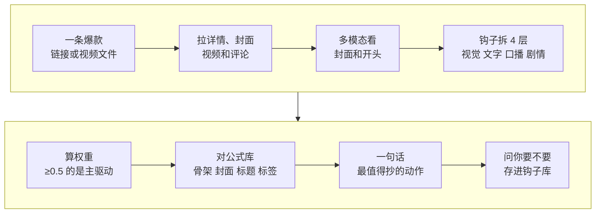

# 3-2 拆钩子和结构：爆款为什么让人看下去

这一课用 social-account-doctor 的“拆爆款”模式，拆一条对标的爆款：开头的钩子由哪几层组成、哪一层最关键，正文是什么骨架，封面和标题套了什么公式，评论区里观众到底在要什么。最后得到一句话：这条最值得你抄的一个动作。

3-1 拆的是“画面是怎么做出来的”，这一课拆的是“内容为什么让人看下去”。

| 项目 | 内容 |
| --- | --- |
| 难度 | 2 |
| 时长 | 20 分钟 |
| 前置 | 1-2（选出这周要拆的爆款；没做也可以直接拿一条你想学的爆款） |
| 产出 | 爆款拆解卡：4 层钩子和权重、骨架、封面公式、标题公式、标签、评论需求、一句话复用建议 |
| 用到的工具 | social-account-doctor（crack 模式） |

## 它是怎么工作的



1. **拿材料**：给链接时，它用浏览器或 TikHub 拉作品详情、封面、视频和评论；给本地文件时，直接用你的文件。
2. **看开头**：用多模态模型看封面和前几秒。钩子不是“那一句标题”，而是开场几秒里画面、文字、口播、剧情一起起作用。
3. **钩子拆 4 层**：视觉钩（第一眼看到什么）、文字钩（封面字和标题）、口播钩（第一句话）、剧情钩（第一秒发生了什么）。每层给一个权重，**权重 ≥ 0.5 的那一层就是主驱动**，仿写时精力花在它上面。
4. **对公式库**：技能内置一套公式词典：5 种封面模板（大字报、对比、真人出镜、实物、表格截图）、10 个标题公式、3 种正文骨架、7 种开头钩子。每个判断都要落到词典里的编号上，这样不同爆款之间才能比较。
5. **看评论**：取前 50–100 条评论做聚类，看观众真正在要什么，比如求教程、问配置、质疑恰饭。评论比点赞更能说明内容打中了什么。
6. **一句话复用建议**：只给一个最值得抄的具体动作。
7. **钩子库（可选）**：拆完它会问你要不要把这几个钩子存进你的钩子库。只有你说要才存，它不会自动存。

## 你要准备什么

| 准备 | 说明 |
| --- | --- |
| 一条爆款 | 1-2 雷达选出来的那条，或者你自己刷到想学的。链接或下载好的视频文件都行 |
| 评论（可选） | 给链接时它会自己拉。给本地文件时，可以附上评论截图或导出的评论 |
| 多模态 Key | 01 课配好的。看封面和开头要用它 |

## 动手：拆你想学的那条爆款

### 实操 1：拆钩子、骨架和评论

```text
用 social-account-doctor 拆一下这条爆款：<链接或视频文件>，评论在 <评论文件，给链接就删掉这句>。我想知道开头的钩子由哪几层组成、哪一层是主驱动，正文是什么骨架，封面和标题套的什么公式，评论区观众最想要什么，每类有多少条。最后用一句话告诉我最值得抄的一个动作。结果放到 成果/3-2。
```

### 实操 2：存钩子库

拆完它会问你要不要存进钩子库。觉得这条钩子以后用得上，就回：

```text
存。按主驱动分类，以后我拆别的爆款也往里加。
```

## 你会拿到什么

一张爆款拆解卡，结构大致是：

| 部分 | 内容 |
| --- | --- |
| 作品信息 | 账号、标题、公开数据、时长 |
| 4 层钩子 | 视觉、文字、口播、剧情各是什么，各占多少权重，主驱动是哪层 |
| 骨架 | 正文分几段、每段起止时间，命中哪种骨架 |
| 封面公式 / 标题公式 / 标签 | 对应公式词典里的编号 |
| 评论需求 | 评论分几类、每类条数和占比、代表评论原话 |
| 复用建议 | 一句话：最值得抄的一个动作 |

录屏里演示用的是课程自制的一条“AI 视频工具排行榜”样片，结果见下方截图。

## 怎么核对结果

- [ ] **时间以字幕为准**：说“钩子 0–3 秒”，打开字幕或拖进度条看第一句话到底在几秒结束。四舍五入成整数秒会让你仿写时节奏不对。
- [ ] **权重加起来说得通**：主驱动只能有一个是 ≥ 0.5 的。几层都写 0.5 以上，说明它没真正判断。
- [ ] **公式有编号**：封面、标题、骨架、钩子都要落到具体编号上。只写“标题很吸引人”不算拆解。
- [ ] **评论数过一遍**：“评论区大多在 XX”要有条数和占比撑着。自己数一下最大的那一类，看占比对不对。
- [ ] **视觉判断看过图**：“封面是大字报型”这种判断，报告里应该有封面图。没看图就下的视觉结论不可信。

## 常见问题

**它拿不到链接里的视频？** 平台页面读不出时，把视频保存到本地再给它。抖音、小红书 App 里很多作品可以直接保存；不能保存的，只用于学习时可以录屏。拆解只为学习做法，不要把原视频再发出去。

**拆出来的东西和我的账号不搭？** 正常。拆解卡记录的是这条爆款本身，下一课 4-1 才是“挑能搬到你账号上的部分”。

**能一次拆几条？** 可以一次给 3–5 条同类爆款，它会逐条拆，最后对比哪些钩子反复出现。反复出现的才是这个赛道的套路。

## 进阶与边界

- **它不打分**：拆爆款只罗列“可以抄的元素”，不评价好坏。想知道你和对标差多少，用 2-1。
- **它不拆画面做法**：这条视频用了哪些 AI 镜头、花字怎么做的，用 3-1 的 rea-video。
- **下载工具**：[Douyin_TikTok_Download_API](https://github.com/Evil0ctal/Douyin_TikTok_Download_API) 可以把分享链接解析成视频文件，但需要自己部署和配置 Cookie。课程不演示；确实要用，控制频率，只用于个人学习，不要转发原视频。

## 下一课

4-1 写我的版本：拿这张拆解卡，套用到你自己的选题上。

## 本次任务结果与核对

录屏演示拆的是课程自制样片“AI 视频工具排行榜”和它的评论区（虚构账号“AI工具铺子”）。

> 作者试跑结果待补：实际产物、发现的问题与修订、交付文件链接。

## 操作画面

截图待录制后补充。

[观看 3-2 实操录屏](../录屏/3-2-WorkBuddy实操.mp4) · [字幕](../录屏/3-2-WorkBuddy实操.vtt)
