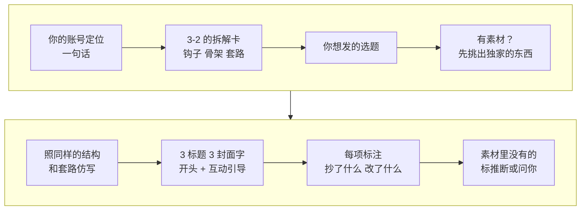

# 4-1 写我的版本：套用爆款结构写新选题

拆完爆款，知道它好在哪了，轮到自己写还是不知道怎么下笔；照着写又怕写成搬运。这一课用 social-account-doctor 的“仿写”模式，拿 3-2 的爆款拆解卡，加上你的账号定位和想发的选题，写出 3 个标题、3 个封面大字、一段开头和一句互动引导。每一项都标明“抄了对标什么、改了什么”，你只抄能复制的部分。选定之后，还能让它写成整条脚本。

手上有自己的素材（笔记、实测数据、拍好的视频）时，先用“素材模式”把素材过一遍，写出来的是只有你有的东西，不只是套模板。

| 项目 | 内容 |
| --- | --- |
| 难度 | 2 |
| 时长 | 20 分钟 |
| 前置 | 3-2（爆款拆解卡；没做也可以给一条爆款链接，让它先拆再写） |
| 产出 | 3 个标题 + 3 个封面大字 + 开头（≤50 字）+ CTA，每项标注公式和“抄了什么 / 改了什么”；选定后的完整脚本 |
| 用到的工具 | social-account-doctor（adapt 模式；有素材时先走 compose） |

## 它是怎么工作的



1. **三样输入**：你的账号定位（一句话，必须）、3-2 的拆解卡（必须）、你想发的选题（可选，不给它会按拆解卡推荐）。
2. **素材模式（有素材时）**：先逐份读你的素材，整理出要讲的事实、只有你有的东西（数据、画面、经历、金句），以及还缺什么。素材里没有的，它应该问你，不能编。
3. **照套路仿写**：沿用爆款的结构，标题、封面、开头、互动引导（CTA）每一项都要用上 3-2 那套套路库（公式词典）里的至少一招。3 个标题各用不同的套路，你发出去就能看出哪种钩子对你的观众有效。
4. **标注来源**：每一项都写“抄了对标什么 + 我做了什么改动”；用了素材的，再写“用了哪条素材”。只能靠通用话术填的位置，标成“推断”。
5. **固定 3 个**：标题、封面字各给 3 个，不多给，多了你反而选不动。

## 你要准备什么

| 准备 | 说明 |
| --- | --- |
| 账号定位一句话 | 做什么内容、给谁看、你的不同。比如“前广告剪辑师，教新手用 AI 做电影感短片” |
| 3-2 的拆解卡 | 或者一条爆款链接，让它先拆 |
| 你想发的选题 | 一句话。没想好可以不给 |
| 你的素材（可选） | 实测笔记、数据、拍好的片段、聊天截图……越具体，写出来越像你 |

## 动手：写你的下一条

### 实操 1：按拆解卡仿写

```text
用 social-account-doctor 帮我仿写下一条。我的定位：<一句话定位>。对标是 3-2 拆过的那条爆款，我想发：<你的选题>。素材在 <你的素材，没有就删掉这句>，素材里没有的数字和事实不要编，缺什么问我。给我 3 个标题、3 个封面大字、一段 50 字以内的开头和一句互动引导，每项标清用了哪个公式、抄了对标什么、改了什么。结果放到 成果/4-1。
```

### 实操 2：说法不实时让它改

逐条看一遍，凡是数字和效果的说法，都回到素材里找出处。找不到的，直接指出来：

```text
“<某个标题或开头里的说法>”在我的素材里找不到依据，<素材里实际是怎么写的>。请改成素材里能对上的说法，别的不动。
```

### 实操 3：要整条脚本时

仿写默认只给标题、封面、开头和 CTA。选定之后，要自己拍，或者要交给下一课的 Hypit，就让它写完整脚本：

```text
我选第 <N> 个标题和这个开头。按对标的骨架把整条脚本写出来，标好每段的起止时间和画面，素材里没有的事实标“待补”。
```

## 你会拿到什么

| 部分 | 内容 |
| --- | --- |
| 标题候选 ×3 | 每个标注命中的标题公式编号，以及改了什么 |
| 封面大字 ×3 | 4 字左右，标注套的封面模板 |
| 开头 | ≤ 50 字，命中一种开头钩子，和封面、首帧一致 |
| CTA | 互动引导，套用对标评论区验证过的需求 |
| 溯源 | 每项“抄了什么 / 改了什么”；素材模式下还有“用了哪条素材”；脑补的部分标“推断” |

录屏里演示账号“阿夏的AI片场”用自己的模型实测笔记，仿写了一条 AI 视频工具排行榜，结果见下方截图。

## 怎么核对结果

- [ ] **每项都有公式编号**：没命中公式的标题，就是平铺直叙，不用发。
- [ ] **抄的是能复制的部分**：抄结构、抄钩子类型可以；抄对标的原句、原创梗、它独有的人设和数据不行。原句照搬还有搬运风险。
- [ ] **数字都有出处**：标题和开头里的每个数字、价格、效果，都要能在你的素材里找到。“不到一块钱”“完全免费”“一键出片”这类说法，素材撑不住就不能写，还容易在 6-1 审核时被判虚假宣传。
- [ ] **推断标出来了**：素材没覆盖、靠通用话术写的位置，应该标“推断”。没标的，你要自己判断是不是它编的。
- [ ] **和封面、首帧一致**：开头说的和封面写的、第一帧画面要对得上，不然观众会觉得被骗。

## 常见问题

**写出来像模板？** 给它更多你自己的素材：你的实测数据、你踩过的坑、你独有的画面。素材越多，“推断”越少。

**三个标题都差不多？** 让它三个各套不同的公式，比如一个数字型、一个反认知、一个身份共鸣，再去测哪个点击率高。

## 进阶与边界

- **它不保证爆**：仿写的是“被验证过的结构”，结果还要发出去看数据。回到 2-2 用单条诊断复盘。
- **它不做事实核查**：它只保证不编素材里没有的东西，素材本身对不对，要你负责。发布前用 6-1 做合规审核。

## 下一课

脚本写好之后，按你做的视频类型选路：

- **字幕卡片、榜单、知识类视频**：接 4-2 把爆款做成模板，一次出多条变体。把对标视频做成能反复用的模板，换成你的文案一次出多个版本。
- **要 AI 画面的视频**：接 5-1 用 AI 生成镜头：把分镜变成画面，再到 5-2 做花字和标题卡，把做法存成配方。
- **实拍、口播**：照脚本自己拍，用剪映等你熟悉的工具剪好，直接跳到 6-1 发布前审核：这条能不能发。4-2、5-1、5-2 可以跳过。

## 本次任务结果与核对

录屏演示用的是演示账号“阿夏的AI片场”的账号资料、模型实测笔记和 3-2 的拆解卡。

> 作者试跑结果待补：实际产物、发现的问题与修订、交付文件链接。

## 操作画面

截图待录制后补充。

[观看 4-1 实操录屏](../录屏/4-1-WorkBuddy实操.mp4) · [字幕](../录屏/4-1-WorkBuddy实操.vtt)
