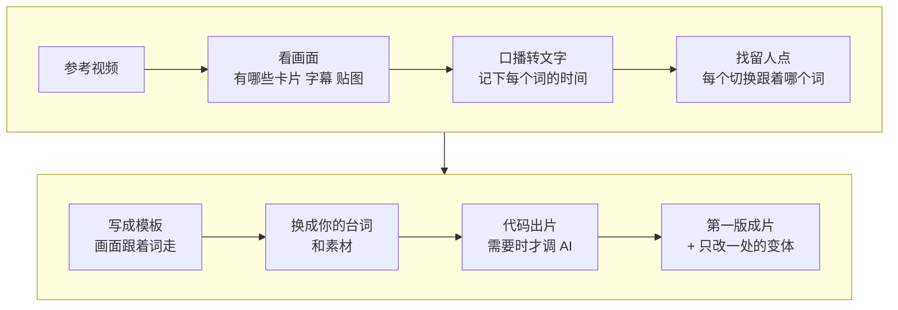

# 4-2 把爆款做成模板，一次出多条变体

对标那条排行榜爆了，你也想做一条同款，可从头剪一遍要大半天；想换个开头试试数据，又得重剪一遍。这一课用 Hypit 技能把对标爆款“克隆”成一个能反复改的模板（工作流）。里面的画面、字幕、卡片、音效都跟着台词里的词走，不按第几秒排。换上你自己的内容，画面会跟着新台词重新排；想换开头或配色，改一处就能再出一条变体。

适合字幕卡片、榜单、知识类视频。做实拍、口播的可以跳过这一课，4-1 写好脚本后自己拍剪，直接去 6-1。

字幕、卡片、排行榜这类视频可以全程用代码做出来，不调用 AI 生成模型，不花模型的钱。

| 项目 | 内容 |
| --- | --- |
| 难度 | 3 |
| 时长 | 40 分钟 |
| 前置 | 4-1（你自己版本的脚本）；最好做过 3-1、3-2 |
| 产出 | 可编辑的 Hypit 工作流 + 你的第一版成片 + 2 条变体 |
| 用到的工具 | Hypit（hypit 技能 + 命令行工具）；配音服务一项（自选） |

## 它是怎么工作的



1. **看画面**：Hypit 先看参考视频，弄清有哪些画面元素：卡片、字幕、贴图、B-roll（穿插的补充画面）。
2. **口播转文字**：把口播转成文字，并记下每个词在第几秒出现。
3. **找留人点**：找出每次切换、每个卡片弹出、每个音效分别是跟着哪个词出来的。爆款的节奏主要就体现在这些对应关系上。
4. **写成模板**：把这些关系写进一份工作流文件。画面挂在词上，不挂在秒上，所以换台词也不会乱。
5. **换内容**：换上你的台词和素材。台词变长变短，卡片和字幕跟着词一起移动。
6. **出片**：字幕、动效、代码画面在你电脑上直接做出来，不用 AI 生成模型。需要 AI 画面时，才接生成服务。
7. **出变体**：模板里只改一处（开头钩子、配色、贴图），其他不动，再出一次片。发出去比数据时，你就知道是哪一处起了作用。

::: 想知道细节：用到的技术
- 第 1 步会从参考视频里抽出代表帧来看。
- 第 2 步用 WhisperX 做逐词转写和时间对齐。
- 第 4 步的工作流文件用的是 Hypit 自己的视频描述语言 SVML，画面锚定到词，不锚定到秒。
- 第 6 步的代码画面在本地渲染。
:::

**和 3-1 rea-video 的区别**：rea-video 告诉你“这条是怎么做出来的”，Hypit 帮你“快速做出同款”。要还原 AI 画面的短剧，用 rea-video 拆再接 5-1；字幕卡片类的排行榜、清单、口播，用 Hypit 更快。

## 你要准备什么

| 准备 | 说明 |
| --- | --- |
| 一条参考爆款 | 字幕、卡片、榜单类效果最好。本地文件最稳 |
| 你的内容 | 4-1 写好的脚本，或者你自己的台词；有自己的产品图、截图也一起放进工作文件夹 |
| Hypit 技能 | 没装的话先装，见下面的安装提示词。它要用到 Node.js 22.15+（运行它的程序环境）和 ffmpeg（处理视频的免费工具） |
| WhisperX | 把口播转成文字、对齐到每个词用。第一次用时 Agent 会说明本地安装和托管服务两种方式，让你选 |
| 配音服务（可选） | 你已经配好的 TTS。没有的话，先出无配音的字幕版 |

Hypit 本身免费、不加水印。走代码渲染不产生模型费用，只有配音或者你选择调用生成模型时才花钱。

**没装 Hypit 的话先装**，把这段发给 WorkBuddy（只需一次）：

```text
帮我安装 Hypit 技能：https://github.com/hypit-ai/hypit。它要用到 Node.js 22 以上，我电脑上没有或版本太低的话先告诉我，我同意后再装。装之前先告诉我它要装哪些东西、会不会联网或花钱，我确认后再装。需要 Key 时停下来，告诉我写到哪，我自己填，不要在对话里显示。
```

装完到 WorkBuddy 的“技能”→“已安装”里看一眼，确认 hypit 的开关是开着的。看不到的话，重启 WorkBuddy 再看；还是没有，到技能页面手动导入，入口以你的版本为准。Hypit 的命令行工具不用你管，第一次使用时 Agent 会检查并帮你装好。

::: 想知道细节：WorkBuddy 会怎么装
Hypit 官方的安装命令是下面这条，WorkBuddy 会替你运行，你不用自己开终端：

```text
npx skills add hypit-ai/hypit -g
```
:::

## 动手：把你的对标爆款变成模板

### 实操 1：克隆并换成你的内容

```text
用 hypit 复刻这条参考视频：<视频文件>。内容换成我的：<4-1 写好的脚本，或你自己的台词>。这条只用卡片、字幕和动效，不调用视频或图片生成模型。动手前先告诉我你对参考视频的理解：哪些画面和音效是跟着哪个词出来的。账号标识换成 <你的账号名>，原视频的水印和标识一律不要。配音用我已经配好的服务，没有就先停下来问我。做完放到 成果/4-2，告诉我用了哪些服务、花了多少钱。
```

### 实操 2：出变体

```text
在同一个工作流上出 2 个变体，其他内容都不动：变体 A 只换开头钩子，改成“<另一个开头>”；变体 B 只换配色和贴图，改成<你的主色和贴图>。最后给我一张三条视频的对比表，说明每条改了什么。
```

## 你会拿到什么

| 部分 | 内容 |
| --- | --- |
| 对参考视频的理解 | 动手前它写下的分析：哪些切换跟着哪个词，为什么留人 |
| 工作流 | 一个可以反复修改、反复渲染的项目，换一句台词就能再出一条 |
| 第一版成片 | 你的内容 + 参考视频的结构和节奏 |
| 2 条变体 + 对比表 | 每条只改了一处，方便发出去比数据 |
| 花费说明 | 用了哪些服务、多少钱 |

录屏里演示账号“阿夏”用的是课程自制的排行榜样片，结果见下方截图。

## 怎么核对结果

- [ ] **理解对不对**：它写下的“哪个画面跟着哪个词”，你对照参考视频看一遍，说得通吗？这一步理解错了，后面全歪。
- [ ] **没有别人的标识**：参考视频里的水印、账号名、头像，克隆时容易被当成版式的一部分一起复刻下来。逐帧拖一遍，确认全换成了你的。
- [ ] **字幕和配音**：字幕和你的台词一字不差，每句字幕和声音同时出现。
- [ ] **变体只改了一处**：三条对比，除了要改的那一处，其他完全一样。别处也变了，让它说明原因。
- [ ] **钱花在哪**：没有调用你没同意的生成模型。

发现问题，直接说哪一条、第几秒、哪里不对，让它在工作流里改了重新渲染。

## 常见问题

**WhisperX 装不上？** 让 Agent 说明本地安装和托管服务两种方式各要做什么，选工作量小的那个。

**能不能直接克隆别人的整条视频发出去？** 不能。克隆的是做法（结构、节奏、版式），内容、素材、标识都要换成你自己的。

**变体有什么用？** 同一条内容，换个开头发在不同时段或平台，看哪个数据好，下次用赢的那个。

**想看时间线、手动微调？** 对它说“打开 Studio 让我看时间线”。Hypit 自带 Studio 预览，可以看到每个组件在时间线上的位置。

**WorkBuddy 里装不上 hypit 技能？** Hypit 官方支持 Claude Code、Codex 等编程 Agent。可以先在这些工具里做，产物放回 `成果/4-2`，后面的课照常用。

## 进阶与边界

- **它不擅长的**：纯卡点踩拍的视频、产品动态海报、电影感短片；不生成 AI 音乐。
- **克隆带 AI 人物的视频**（选学，录屏不演示）：需要接一个视频生成服务。可以用 HypiHub 或你自己的 API；也可以用 [comfyui-hypit-bridge](https://github.com/Ero-Cat/comfyui-hypit-bridge) 把 AutoDL 上的开源 MiniMax H3 接成 Hypit 的生成服务（显存 24GB 以上，配置文件只留在本地，用完立刻关机）。

## 下一课

5-1 用 AI 生成镜头：把分镜变成画面。按 3-1 的复刻方案，把需要 AI 画面的镜头生成出来。

这一课的成片只有字幕、卡片和动效、不需要 AI 画面的话，可以跳过 5-1、5-2，直接去 6-1 发布前审核：这条能不能发。

## 本次任务结果与核对

录屏演示用的是课程自制样片《AI 视频工具排行榜》，内容换成演示账号“阿夏”在 4-1 写好的脚本。

> 作者试跑结果待补：实际产物、发现的问题与修订、交付文件链接。

## 操作画面

截图待录制后补充。

[观看 4-2 实操录屏](../录屏/4-2-WorkBuddy实操.mp4) · [字幕](../录屏/4-2-WorkBuddy实操.vtt)
