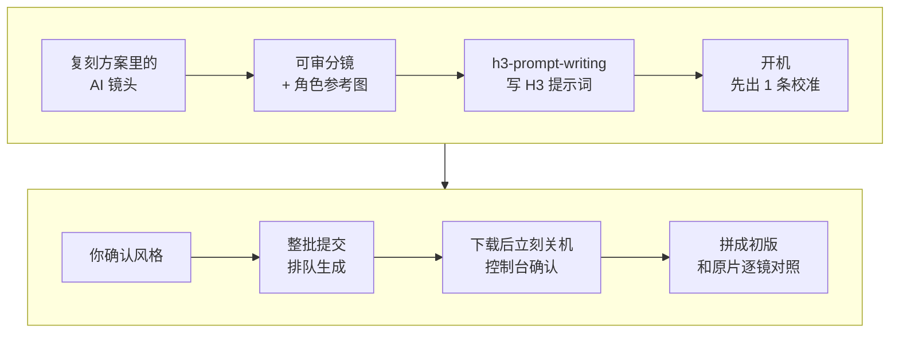

# 5-1 用开源 H3 生成你的 AI 镜头

这一课按 3-1 写好的复刻方案，用开源视频模型 MiniMax H3 把需要 AI 画面的镜头生成出来，拼成一条初版成片。这一课要养成两个习惯：先出一个校准镜头，确认了再批量；自己租 GPU 的，生成完立刻关机。

H3 有两种接法：自己在 AutoDL 租 GPU 跑（录屏演示这种），或者直接调 API。两种接法的提示词和流程几乎一样。

| 项目 | 内容 |
| --- | --- |
| 难度 | 3 |
| 时长 | 60 分钟（其中等待生成约 20 分钟） |
| 前置 | 3-1（复刻方案） |
| 产出 | 可审分镜 + 角色参考图 + 校准镜头 + 批量镜头 + 初版成片 + 生成记录和逐镜对照 |
| 用到的工具 | open-source-video-gen-skill 的 h3-prompt-writing、minimax-h3、autodl-app-instance（可选 character-three-view、qwen3-tts）；capsule-cinema（分镜、质检；走 API 时也负责生成） |

## 它是怎么工作的



1. **出分镜**：capsule-cinema 把复刻方案整理成可审的分镜：每镜时长、景别、运镜、画面内容。这一步不开机、不花钱。
2. **角色参考图**（可选）：character-three-view 给你的角色出一张三视图，后面每一镜都拿它做参考，人物才不会变样。
3. **写提示词**：h3-prompt-writing 把每一镜写成 H3 能听懂的提示词（文字、参考图、首尾帧）。H3 单次最短 5 秒，短镜头先生成 5 秒、拼接时再裁。
4. **开机、出校准镜头**：autodl-app-instance 开机，minimax-h3 只提交一镜，挑最难的那一镜（人多、场景大、动作复杂）。
5. **你确认**：校准镜头过了，其他镜头大概率也能过；不过就改提示词再试，不要直接批量。
6. **整批生成**：一次开机，把剩下的镜头全部排进队列，别让 GPU 空转。
7. **下载、关机**：全部下载完立刻关机，自己到控制台确认。裁剪、拼接、加字幕都在关机后本机做。
8. **对照**：和原片逐镜比，列出要返工的镜头。下一课只返工其中一镜。

## 你要准备什么

| 准备 | 说明 |
| --- | --- |
| 3-1 的复刻方案 | 里面有哪些镜头要 AI 生成、每组的提示词和参考图清单 |
| 你的人物和故事 | 一两句话：主角长什么样、故事怎么换。角色一律 AI 原创，不用明星或真人的脸 |
| H3 的接法（二选一） | 自己租 GPU：AutoDL 账号 + MINIMAX-H3 应用实例 + 开发者 Token；或者直接调 API：MiniMax 或 RunningHub 的 API Key |

两种接法怎么选：

| 接法 | 怎么收费 | 好处 | 要注意 |
| --- | --- | --- | --- |
| 自己在 AutoDL 租 GPU（录屏演示） | 只收 GPU 租金，按秒计费，10 秒 1080p 约 ¥0.3 | 量大时最便宜 | 要开关机；本地跑的是量化版 H3-Base，不含官方的 2K 重生成 |
| 直接调 API | 按次计费，历史参考价 5 秒 768p 约 ¥2.50，以平台当日价格为准 | 不用部署、不用关机；官方 API 带完整提示理解和 2K 输出 | 单条贵 |

一个月只出几条，直接调 API 省事；每周都要批量出镜头，租 GPU 更便宜。算账时别只比单次价格：租 GPU 还有开机等待、空转、失败重跑的时间成本。

### 准备 AutoDL（自己租 GPU，只需一次）

1. 注册 [AutoDL](https://www.autodl.com) 并充值少量金额（按秒计费）。
2. 控制台 → 应用实例 → 应用市场选 **MINIMAX-H3**，创建一台实例。实例 ID 不用记，技能会自己找。
3. 账号 → 设置 → **开发者 Token**，创建并复制。
4. 把 Token 存到本机私有文件（在终端运行，`你的Token` 换成实际值）：

```text
mkdir -p ~/.config
echo 'export AUTODL_TOKEN=你的Token' > ~/.config/autodl.env
chmod 600 ~/.config/autodl.env
```

5. 安装 [open-source-video-gen-skill](https://github.com/mini-yifan/open-source-video-gen-skill)：克隆仓库，`pip3 install -r requirements.txt`，再把 `skills/` 下的技能导入 WorkBuddy 的技能页面。它的说明里写的是软链到 ZCode / Cursor 的技能目录，WorkBuddy 的导入方式以你的版本为准。

Token 能开关你的 GPU、产生费用，不能出现在对话、提示词、截图和仓库里。准备好后，对 WorkBuddy 说“检查一下 AutoDL 环境配置”，它能列出你的实例就对了。

### 另一种接法：不租 GPU，直接调用 API

让 Capsule Cinema 直接调 H3 的 API，两个渠道选一个：

| 渠道 | 去哪拿 Key | 本机配置里的变量名 | 说明 |
| --- | --- | --- | --- |
| MiniMax 官方 API | [MiniMax 开放平台](https://platform.minimaxi.com) | `MINIMAX_API_KEY` | 完整 H3 系统，输出 2K；Capsule Cinema 里指定 `video_engine=minimax-h3` |
| RunningHub | [RunningHub](https://www.runninghub.cn) | `RUNNINGHUB_API_KEY` | 跑的是开源 H3-Base 工作流，支持文生视频、首尾帧、多图参考 |

Key 和 AutoDL Token 一样写进本机私有文件，具体位置按 Capsule Cinema 的 [安装说明](https://raw.githubusercontent.com/JuneYaooo/cheap-claude-video/main/docs/install.md)。走 API 时，把下面提示词里的“用 autodl-app-instance 和 minimax-h3 开机生成”换成“用 capsule-cinema 的 H3 渠道生成”，删掉开关机的要求。API 按次计费，校准镜头更不能省。

## 动手：生成你自己的 AI 镜头

### 实操 1：先出分镜，不开机

```text
读 3-1 的复刻方案，给我做一份可审的分镜：沿用原片的镜头结构、时长、景别和运镜，人物和故事换成我的：<一两句话说你的主角和故事>。原片的角色、台词、标志性道具都不能出现。代码能做的花字和标题卡只标注，下一课做。用 capsule-cinema 整理分镜，用 character-three-view 给主角出一张参考图（AI 原创，不像任何真人），用 h3-prompt-writing 给需要 AI 生成的镜头写提示词。先不要生成视频，放到 成果/5-1。
```

### 实操 2：只出一个校准镜头

```text
分镜可以。先只生成一个校准镜头：<最难的那一镜，比如人多、场景大的那镜>。用 autodl-app-instance 和 minimax-h3 开机生成，下载后立刻关机，Token 不要在对话里显示。记下开关机时间和费用，告诉我实例现在的状态。
```

### 实操 3：整批生成，拼成初版

```text
校准镜头可以。按同样的风格把剩下的 AI 镜头一次生成完：一次开机，全部排进队列，下载完立刻关机。关机后拼成初版成片，代码镜头先放黑场占位，加上字幕和我的水印。再逐镜对照原片：景别、运镜、时长有没有还原，主角每一镜是否一致，有没有人物重复或变形。不合格的列成待返工清单，写清哪里不对、提示词怎么改。这次的开关机时间和费用也记上。
```

## 你会拿到什么

| 部分 | 内容 |
| --- | --- |
| 可审分镜 | 每镜时长、景别、运镜、画面内容，哪镜 AI、哪镜代码 |
| 角色参考图 | 主角的三视图，后面每镜都参考它 |
| 校准镜头 | 最难的那一镜，先看风格和人物对不对 |
| 批量镜头 + 初版成片 | 代码镜头位置是黑场占位，下一课补 |
| 生成记录 | 每次开机、生成、关机的时间和费用 |
| 逐镜对照和待返工清单 | 哪镜不合格、为什么、提示词怎么改 |

录屏里演示账号“阿夏”把穿越短剧样片换成了自己的故事：剪辑师阿夏穿越到唐朝西市，结果见下方截图。

## 怎么核对结果

- [ ] **先审后生成**：分镜阶段没有开机。
- [ ] **校准先行**：先只出了一镜，你确认后才批量。
- [ ] **真的关机了**：自己到 AutoDL 控制台看一眼，实例显示“已关机”。不要只听 Agent 说关了。
- [ ] **人物一致**：主角的发型、衣服、道具每一镜都一样；没有出现两个主角；肢体没有变形。
- [ ] **没有原片的东西**：原片的角色、台词、水印都没有出现。
- [ ] **账对得上**：生成记录里每次开关机时间和费用都在，和控制台的账单大致对得上。
- [ ] **Token 没露出**：对话、截图、文件里都没有 Token。

要是忘了关机，立刻到控制台手动关掉。以后每次看完结果，先去控制台看一眼。

## 常见问题

**生成一镜要多久？** 5 秒的镜头，服务端大约跑 2 分钟。多镜排队并发，总共等十几分钟。

**为什么生成出来是 5.17 秒、704 宽？** H3 的时长和尺寸按固定块取整。拼接前统一裁剪、缩放就行，这一步技能会处理。

**同样的提示词再生成，结果一模一样？** 固定种子下会这样。想换结果，就改一点提示词或参考图。

**旁白怎么做？** 可以让它在同一次开机里用 qwen3-tts 生成；当前实例不支持就用 H3 自带的声音，或者关机后用你自己的配音服务。

**能不能用明星的脸做角色？** 不能。这是最常见的限流原因之一（6-2 会讲）。角色一律 AI 原创。

## 进阶与边界

- **它做不到的**：本地 AutoDL 跑的是量化版 H3-Base，不等于官方 2K 链路；精确的文字、标题、花字用代码做更稳（5-2）。
- **没有预算时**：既不租 GPU、也不调 API，就只做实操 1 的分镜和提示词，代码镜头照常在 5-2 用 HyperFrames 做，不需要 GPU。

## 下一课

5-2 用 HyperFrames 做花字模板：把代码镜头和花字做出来替换进成片，只返工一镜，再把整套做法存成配方。

## 本次任务结果与核对

录屏演示走的是“自己在 AutoDL 租 GPU”的接法，复刻对象是课程自制样片《外卖员穿越唐朝》，换成演示账号“阿夏”的唐朝西市故事。

> 作者试跑结果待补：实际产物、发现的问题与修订、交付文件链接。

## 操作画面

截图待录制后补充。

[观看 5-1 实操录屏](../录屏/5-1-WorkBuddy实操.mp4) · [字幕](../录屏/5-1-WorkBuddy实操.vtt)
