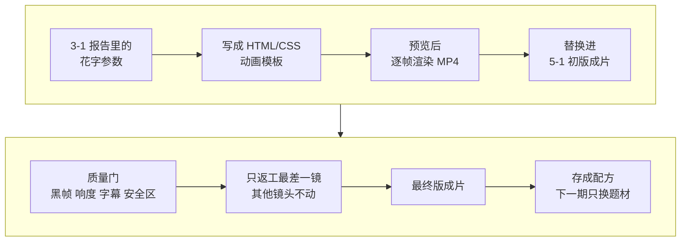

# 5-2 用 HyperFrames 做花字模板，再把做法存成配方

这一课做两件事。第一，用 HyperFrames 写代码做出 3-1 拆出来的花字和标题卡：字体、颜色、出现时间都能精确控制，改一个字不用重新生成，也不花 GPU 的钱。第二，用 Capsule Cinema 给成片过一遍质量门，只返工最差的一镜，再把整套做法存成“配方”，下一期只换题材就能照做。

| 项目 | 内容 |
| --- | --- |
| 难度 | 3 |
| 时长 | 45 分钟（返工生成约 5 分钟） |
| 前置 | 5-1（初版成片和待返工清单）；3-1（花字参数） |
| 产出 | 可换字的花字和标题卡模板 + 最终版成片 + 质检和返工记录 + 一份配方 |
| 用到的工具 | HyperFrames（hyperframes 技能）；capsule-cinema（质量门、单镜返工、配方）；返工生成沿用 5-1 的 H3 接法 |

## 它是怎么工作的



**HyperFrames 这一半**：

1. **读参数**：从 3-1 的报告里拿到花字的文字、字体、颜色、描边、出场方式和出现时间。
2. **写模板**：用网页（HTML/CSS）写画面，用可逐帧定位的动画控制每个字什么时候出来。文字做成可替换的参数。
3. **预览、渲染**：先预览，再一帧一帧渲染成 MP4。同样的输入，每次渲染结果完全一样。
4. **替换进成片**：需要叠在 AI 画面上的花字，把那一镜的画面放进 HyperFrames 一起渲染，出一整个镜头，直接替换。

**Capsule Cinema 这一半**：

5. **质量门**：自动查黑帧、响度、字幕是否压在安全区外、画幅尺寸。
6. **单镜返工**：只改最差那一镜的提示词、只重新生成这一镜，其他镜头一帧不动。
7. **存配方**：把镜头结构、校准先行、提示词写法、花字样式、质检项和返工经验存下来；这一期的故事、台词、密钥不存。下一期说“用这个配方做一期 XX”，结构和规矩都沿用。

## 你要准备什么

| 准备 | 说明 |
| --- | --- |
| 3-1 的拆解报告 | 花字和标题卡的参数都在里面 |
| 5-1 的初版成片和待返工清单 | 这一课在它上面改 |
| Node.js 22+、ffmpeg | 01 课已装好 |
| 5-1 用的 H3 接法 | 只返工一镜时要用。没有预算可以跳过返工 |

**安装 HyperFrames（只需一次）**：在终端运行下面这条命令，会装好 4 个核心技能（hyperframes、hyperframes-cli、hyperframes-registry、media-use）。WorkBuddy 没有自动识别时，到技能页面手动导入。

```text
npx hyperframes skills update
```

HyperFrames 里的 `reverse-any-video`（整条视频反向重建）和 `style-sampling`（套用现成风格出新一期）是付费的 Pro 功能，这门课不用。

## 动手：做你的花字，存你的配方

### 实操 1：做花字和标题卡

```text
用 hyperframes 照 3-1 报告里的花字参数，给我的成片做代码动效镜头，不调用任何生成模型：<要做的标题卡和花字，写清文字>。样式和出现时间照原片。做成以后能换文字反复用的模板，渲染后替换进 5-1 的初版成片，再列一张表对比原片和我的版本：文字、样式、出现时间。放到 成果/5-2。
```

### 实操 2：质检，只返工一镜

走 API 的，把“下载后立刻关机”删掉。

```text
用 capsule-cinema 给成片做一遍质量检查。然后只返工 5-1 待返工清单里最严重的那一镜：按清单改提示词，只重新生成这一镜，下载后立刻关机。替换时其他镜头一律不动，并证明它们没被改过。导出最终版成片，再质检一次，把返工改了什么、花了多少钱记下来。
```

### 实操 3：存成配方

```text
这条的做法我满意了。用 capsule-cinema 把这次的做法整理成一份配方：只存可复用的方法，比如镜头结构、校准镜头先行、提示词写法、花字样式、质检项和返工经验；这一期的故事、台词、角色名和任何密钥都不要存。先告诉我准备存哪些内容，我确认后再写入，另外给我一份人能看懂的配方说明。
```

## 你会拿到什么

| 部分 | 内容 |
| --- | --- |
| 花字和标题卡模板 | 可编辑的项目，换文字重新渲染就是新的花字 |
| 花字对照表 | 原片和你的版本：文字、样式、出现时间 |
| 质检记录 | 黑帧、响度、字幕安全区、画幅等检查结果，返工前后各一次 |
| 返工记录 | 改了哪一镜、提示词怎么改的、花了多少钱；其他镜头没动的证明 |
| 最终版成片 | 6-1 发布前审核要用它 |
| 配方 + 配方说明 | 下一期照着做的方法，不含这一期的内容 |

录屏里演示账号“阿夏”做的是唐朝穿越短剧的标题卡“大唐 · 开元十年”和花字“电量 0%”，结果见下方截图。

## 怎么核对结果

- [ ] **花字时间对不对**：用播放器拖到花字出现的前后各一帧，前一帧没有字、后一帧有字。花字最常见的错是被放到镜头起点，比原片早出来。
- [ ] **样式对不对**：颜色、描边、字体、出场动画和对照表一致。字体不对，多半是电脑上没有那个字体。
- [ ] **没调生成模型**：花字和标题卡全是代码渲染的。
- [ ] **只动了一镜**：返工记录里能看到其他镜头前后一致的证明（比如文件校验值没变）。
- [ ] **质检过了**：最终版的质检没有未处理的问题。
- [ ] **自己租 GPU 的，控制台显示已关机。**
- [ ] **配方干净**：它列出的“准备存哪些内容”里，没有这一期的台词、角色名、密钥、临时文件路径。有就让它去掉再确认。

## 常见问题

**渲染出来字体不对？** 让 Agent 换成本机已有的字体，或把字体文件放进项目里。

**花字能做成透明背景叠在视频上吗？** 可以试，但最稳的做法是把那一镜的画面放进 HyperFrames 一起渲染，出一整个镜头。

**返工后新镜头和前后接不上？** 改提示词时写清上一镜结束和下一镜开始的画面，或用上一镜最后一帧做参考图。

**配方存在哪？能给别人用吗？** 存在 Capsule Cinema 自己的配方目录里，可以打包迁移到另一台电脑。

**没有预算返工？** 跳过实操 2 的返工部分，只做质检，导出替换了花字的版本作为最终版。

## 进阶与边界

- **什么镜头该用代码做**：标题卡、字幕、花字、数字、排行榜、图表、软件界面，要求文字一个都不能错、出现时间精确到 0.1 秒的，用代码。人物、表演、真实场景，用 AI 生成。
- **Capsule Cinema 不是一键成片**：它不提供算力，生成渠道要你自己选；内置配方以剧情、种草、国风讲解为主，你的赛道要靠自己做出第一条再蒸馏。

## 下一课

6-1 发布前审核：用 self-media-compliance-review 审你的成片和发布文案，找出可能被限流甚至下架的风险。

## 本次任务结果与核对

录屏演示用的是演示账号“阿夏”在 5-1 生成的唐朝西市短剧初版，返工生成走 AutoDL。

> 作者试跑结果待补：实际产物、发现的问题与修订、交付文件链接。

## 操作画面

截图待录制后补充。

[观看 5-2 实操录屏](../录屏/5-2-WorkBuddy实操.mp4) · [字幕](../录屏/5-2-WorkBuddy实操.vtt)
