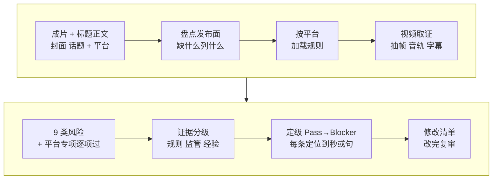

# 6-1 发布前审核：用技能审你自己的成片

这一课用 self-media-compliance-review 的“发布前合规”模式，在发布前把你自己的成片连同标题、正文、封面、话题一起审一遍。你会拿到一份风险报告：每条风险有等级、有证据位置（第几秒、哪一句）、有具体改法；改完再让它复审一次。

它不是敏感词表，也不是法律意见。它做的是：把视频里看得见、听得见、写出来的每一处都过一遍，指出哪里可能出事、证据在哪、怎么改。

| 项目 | 内容 |
| --- | --- |
| 难度 | 2 |
| 时长 | 25 分钟（其中抽帧、提取音轨约 5 分钟） |
| 前置 | 01（技能装好、本机有 ffmpeg） |
| 产出 | 审核报告（结论等级、风险明细、待核验、复审清单）；修改后的文案；复审报告 |
| 用到的工具 | self-media-compliance-review（发布前合规模式） |

## 它是怎么工作的



1. **盘点发布面**：把这条内容所有公开的地方列出来：视频、首帧、封面、标题、字幕、配音、BGM、正文、话题、评论引导、链接、二维码。你没给的，它照常往下审，但会列成缺口。
2. **按平台加载规则**：抖音、快手、B 站、小红书、视频号、公众号各有一份规则文件。比如抖音要求 AI 合成、可能被误认为真实的内容必须显著标注。TikTok 等没有专门规则的平台，只走通用流程，它会说明这一点。
3. **视频取证**：用 ffmpeg 抽出开头 0–5 秒、每次切镜、周期帧和结尾帧，拼成联系表；提取音轨和字幕，可选做语音转写。这一步只准备证据，不下结论。
4. **逐项过 9 类风险**：版权肖像、低俗、暴力不适、违法、营销带货、不实信息、诱导导流、公序良俗、制作质量，再叠加平台专项。光是题材敏感不算问题，必须指出具体哪一处画面、声音或文字有风险。
5. **证据分级**：官方规则、监管文件、媒体报道、创作者讨论、自动检测信号、它自己的观察，分开写。创作者经验只是线索，不等于平台规则。
6. **定级**：Blocker（红线，必须先处理）、High（大概率违规）、Medium（看情况，需要标注或补证明）、Low（小问题）、Pass。每条都要指到时间点、字幕行或文案句。
7. **覆盖检查**：只要还有声音或画面没审到，整体结论就不能是 Pass，没审到的写进“待核验”。
8. **修改清单 → 复审**：改法写成能直接做的动作：哪一段消音、哪一帧打码、哪句话怎么改、补什么授权。你改完，再交给它复审。

## 你要准备什么

| 准备 | 说明 |
| --- | --- |
| 成片 | 准备发布的最终版视频文件，放进工作文件夹 |
| 发布文案 | 标题、正文、话题、封面大字；评论区打算置顶的话也一起给 |
| 目标平台 | 发哪个平台就审哪个平台。同时发几个平台，就说清楚 |
| 制作说明（推荐） | 素材从哪来、哪些是 AI 生成的、BGM 和字体有没有授权、有没有用到真人。给得越全，“待核验”越少 |
| 本机 ffmpeg | 01 课已经检查过。没有它，视频取证做不了，画面和声音只能标“待核验” |

不需要任何 Key，审核在你自己电脑上完成。

## 动手：审你自己的成片

### 实操 1：交给它审

```text
用 self-media-compliance-review 帮我审一下这条准备发 <平台> 的视频：<成片文件名>，连同发布文案一起审，制作说明也在文件夹里。画面、声音、字幕、标题、正文、话题、评论引导和 BGM 都要看。每条风险告诉我等级、在第几秒或哪一句、怎么改；没审到的列为“待核验”，别因为抽样看着没问题就判通过。平台规则和创作者经验分开写。结果放到 成果/6-1。
```

### 实操 2：按清单改完，复审

```text
我按报告改好了：<说清你改了什么，比如标题去掉了“全网最强”、正文开头加了 AI 生成声明、BGM 换成了平台音乐库的>。改后的文案和视频在文件夹里，请复审一次，开头给我一张修改前后的等级对照表，还没解决的写清还差什么。
```

### 实操 3（可选）：换个平台再审

```text
同一条视频我还想发 <另一个平台>，按那个平台的规则再审一遍，只列出和上一份报告不一样的地方。
```

## 你会拿到什么

一份审核报告，结构大致是：

| 部分 | 内容 |
| --- | --- |
| 结论 | 整体等级（Pass / Low / Medium / High / Blocker）和最高风险是哪一条 |
| 风险明细 | 每条一行：等级、对应的规则或风险类别、证据位置（00:03、标题、正文第 2 句……）、说明、改法 |
| 待核验 | 没审到、或证据不够下结论的地方，以及要补什么材料 |
| 已审范围 | 它实际看了哪些时间点、听了哪些段落 |
| 复审清单 | 改完发布前要逐条确认的事项 |

录屏里演示账号“阿夏的AI片场”的报告见下方截图。你的报告会按你的内容和平台给出不同结果。

## 怎么核对结果

这些规则来自技能自己的要求，照着查：

- [ ] **每条都有证据位置**：没有时间点、字幕行或文案句的风险，让它补上定位，或者删掉。
- [ ] **回到成片亲眼看**：挑一两条带时间点的风险，把视频拖到那一秒，确认画面或声音上真有这个东西。对不上的，告诉它“第 X 秒画面上没有 XX，请重新定位”。
- [ ] **没审到的不能是 Pass**：报告里如果写着“未转写音频”“只抽了部分帧”，整体结论却是 Pass，这是不对的，要求它改成“待核验”。
- [ ] **规则和经验分开**：写着“平台规定”的条目，看它引用的是不是规则原文；“听说”“很多人”这类来源只能算经验。
- [ ] **改法能直接做**：“注意版权”不算改法；“00:12–00:20 的 BGM 换成平台音乐库曲目，并在制作说明里写明来源”才算。
- [ ] **改了文案不等于改了视频**：字幕改了但配音里还在说，或者制作说明写了换 BGM、成片里没换，复审时它应该继续标出来。

## 常见问题

**报告说“音频待核验”？** 说明它没有做语音转写，听不到配音里说了什么。把你的口播稿或字幕文件放进文件夹，告诉它“口播稿在这里”，再审一次。

**AI 生成的内容一定要标吗？** 看平台和内容。抖音的规则要求可能让人误以为真实的 AI 合成内容做显著标注；人物写实、像真实事件的，风险更高。报告会按你选的平台给出依据。

**Blocker 和 High 都要改吗？** Blocker 不处理不能发；High 要么改，要么补上证明（授权、资质、来源），并在报告里说明为什么能接受。

**审过了就一定能过审吗？** 不能保证。平台规则会变，审核也有人工判断。它能做的是把已知风险提前找出来、留下证据。

## 进阶与边界

- **它做不到的**：抽帧会漏掉极短的画面；OCR、语音转写和模型判断都可能出错，只能当线索；不替平台下结论，也不提供法律意见。
- **带货内容**：涉及商品、价格、功效、小黄车时，它会加一套电商审核（商品一致性、千川素材质量、功效宣称）。本课不展开。
- **想查最近的处罚案例**：可以明确让它“搜一下最近的类似案例”。默认不联网；联网时它优先用自带浏览器，付费接口会先问你。

## 下一课

6-2 被限流了怎么办：作品已经发出去并被限流时，用同一个技能排查原因、准备申诉。

## 本次任务结果与核对

录屏演示审的是“阿夏的AI片场”5-2 做好的穿越短剧成片和它的发布文案草稿，目标平台抖音和小红书。

> 作者试跑结果待补：实际产物、发现的问题与修订、交付文件链接。

## 操作画面

截图待录制后补充。

[观看 6-1 实操录屏](../录屏/6-1-WorkBuddy实操.mp4) · [字幕](../录屏/6-1-WorkBuddy实操.vtt)
