# v0.7 改版方案：从“教判断”改成“教会用 AI + 技能拿结果”

> 起因（2026-11-03 用户反馈）：
> 1. 课程在教“怎么找对标”，而不是“怎么用 AI 找对标”。给 4 个候选让 AI 判断，没解决学员的痛点：学员就是不知道怎么快速在网上找到对标。
> 2. 每课要有流程图，讲清技能的核心原理。
> 3. 有技能的课，核心是教会学员用这个技能拿到想要的结果：怎么用、原理是什么、能拿到什么结果。
> 4. 学员有自己的账号和想做的内容，不需要模拟。阿夏的模拟素材只给 Codex 在 WorkBuddy 里录屏演示用。

## 一、每课的新结构

```text
# 课号 标题（用 XX 技能做 YY）
一句话：这一课你会用什么技能，拿到什么结果
## 它是怎么工作的        ← Mermaid 流程图 + 每一步一句话（来自技能源码，不编）
## 你要准备什么          ← 学员自己的账号/链接/截图/视频；需要的 Key；没有时怎么办
## 动手：用你自己的账号    ← 1–3 条只写需求的提示词
## 你会拿到什么          ← 产物的结构，好结果长什么样（录屏里阿夏的结果作示例截图）
## 怎么核对结果          ← 用技能自己的规则核对：完整度标注、数字出处、置信度、待核验……
## 常见问题 / 坑         ← 搜不到、没 Key、数据拿不到、平台差异
## 进阶与边界            ← 技能做不到什么；只提不演示的工具（MediaCrawler 等）
```

去掉：“快速实操：照着提示词做一遍”中针对预埋错误的纠正提示词（实操 2）、按练习包写死的数字核对点、“课前文件”。
保留：讲解录屏、截图、下一课。录屏里“发现错误 → 纠正”改成“演示怎么核对”：如果真出现了问题就当场纠正，没出现就展示核对动作。

## 二、练习包怎么处理

- 网站不再给学员“练习包”。首页“下载练习包”改成“开始前准备：你的账号主页链接 / 后台截图 / 一条想学的爆款视频”。
- 阿夏的素材整体移到 `录屏方案/演示素材/`，只给 Codex 录屏用；讲义里只说“录屏里用的是演示账号‘阿夏的AI片场’”。
- 两条自制样片仍需要：录屏时用它们代替“别人家的爆款”，避免课程里传播他人作品。

## 三、逐课方案

| 课 | 新标题 | 技能 / 模式 | 学员输入（自己的） | 拿到的结果 | Codex 演示输入 |
| --- | --- | --- | --- | --- | --- |
| 00 | 总纲：用 AI 跑通一个自媒体账号 | — | — | 学习路线、每课结构 | 网站导览 |
| 01 | 入门：装好技能，配好 Key | WorkBuddy + 全部技能 | 自己的工作文件夹 | 技能可用、环境检查表、多模态 Key 配好 | 空文件夹 |
| 1-1 | 用 AI 全网找对标 | social-account-doctor · find | 主页链接或一句话赛道 | 5–10 个真对标 + 命中特征 + 你勾选的 3–5 个 | 赛道“AI 短片 / AI 视频工具教程”，抖音实搜 |
| 1-2 | 对标爆款雷达：找出对标这周真正爆的那条 | benchmark-outlier-radar | 1-1 的对标；让 Agent 整理它们近 20 条的赞评藏 | 周报：倍数、档位、置信、⚠️ 待核对 | 1-1 实搜到的对标，Agent 整理公开数据 |
| 2-1 | 账号体检：我差在哪 | social-account-doctor · diagnostic | 主页链接（或后台截图） | 漏斗 + 对标扫描 + 六维评分 + P0/P1/P2 | 阿夏后台截图（演示素材） |
| 2-2 | 单条诊断：这条为什么不爆 | social-account-doctor · diagnostic（单条） | 一条作品的后台数据截图 | 卡在漏斗哪一层 + 改法 | 阿夏 ax-033 后台截图 |
| 3-1 | 逐镜拆解：看懂爆款是怎么做出来的 | rea-video | 一条对标爆款视频文件 | 一句话结论 + 逐镜表 + 复刻方案 | 样片 1（穿越短剧） |
| 3-2 | 拆钩子和结构：爆款为什么让人看下去 | social-account-doctor · crack | 同一条爆款（链接/文件 + 评论） | 4 层钩子权重、骨架、可抄元素 | 样片 2（排行榜）+ 评论区 |
| 4-1 | 写我的版本：套用爆款结构写新选题 | social-account-doctor · adapt（素材多时先 compose） | 账号定位一句话 + 想发的选题 + 自己的素材 | 3 标题 + 3 封面字 + 开头 + CTA，每项“抄了什么/改了什么” | 阿夏的模型实测笔记 |
| 4-2 | 用 Hypit 把爆款变成模板，一次出多个变体 | Hypit | 对标爆款视频 + 自己的内容 | 可复用工作流 + 初版 + 变体 | 样片 2 + 4-1 脚本 |
| 5-1 | 用开源 H3 生成 AI 镜头 | open-source-video-gen-skill（AutoDL）/ API | 3-1 的复刻方案 + 自己的角色和故事 | 校准镜头 → 批量镜头 → 初版成片 | 阿夏版穿越 |
| 5-2 | 用 HyperFrames 做花字模板，存成配方 | HyperFrames + Capsule Cinema | 3-1 报告里的花字参数 + 5-1 初版 | 可换字模板、终版成片、下集配方 | 阿夏版穿越 |
| 6-1 | 发布前审核：用技能审你自己的成片 | self-media-compliance-review · 发布前 | 自己的成片 + 标题文案封面 + 平台 | 等级 + 逐条定位 + 修改清单 → 复审 | 5-2 成片 + 阿夏发布资料 |
| 6-2 | 被限流了：排查原因、准备申诉 | self-media-compliance-review · 排查 | 后台通知截图（没被限流就做预防自查） | 原因按证据强弱排序、整改顺序、申诉材料清单 | 阿夏限流通知截图 |
| 07 | 结课：用你自己的账号跑一遍，每周循环 | 全部 + radar 台账/上期复盘 | 自己的账号 | 自己的作品包 + 每周复盘模板 | 阿夏完整走一遍（录屏） |

## 四、各课流程图（来自技能源码）

### 1-1 social-account-doctor · find

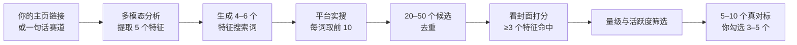

5 个特征：载体形态、情绪锚点、审美、内容结构、反差点（`social-account-doctor/SKILL.md` §2）。筛选：粉丝是你的 1–10 倍、近 30 天 ≥8 条、有单条互动 ≥ 均值 3 倍、排除蓝 V 和单条百万的偶发号。

### 1-2 benchmark-outlier-radar

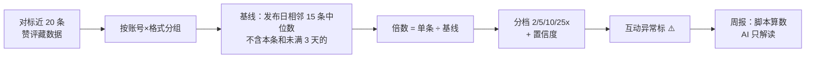

抖音、小红书看不到别人的播放量，用互动倍数（`--metric interactions`）。数据获取：让 Agent 用浏览器读对标主页整理；YouTube 用 RSS；MediaCrawler 只提不演示。

### 2-1 / 2-2 social-account-doctor · diagnostic

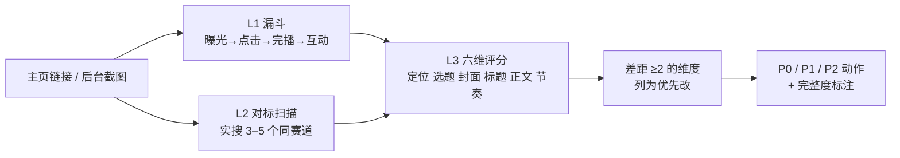

### 3-1 rea-video

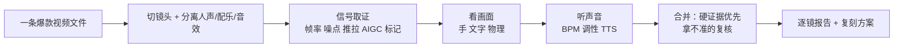

### 3-2 social-account-doctor · crack

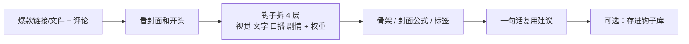

### 4-1 social-account-doctor · adapt

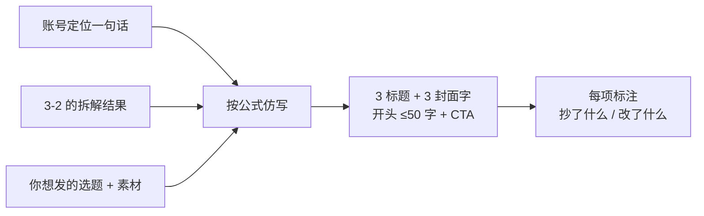

### 4-2 Hypit

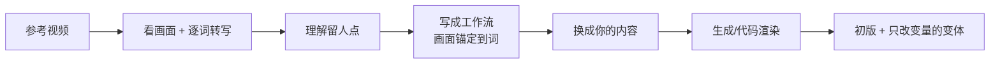

### 5-1 H3

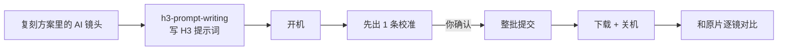

### 5-2 HyperFrames + Capsule Cinema

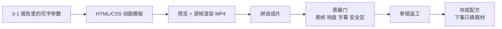

### 6-1 / 6-2 self-media-compliance-review

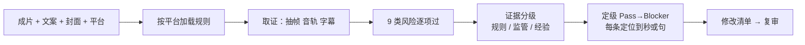

6-2 把输入换成“后台通知截图 + 作品 + 受限功能”，中间多一步“场景手册匹配”，输出“整改顺序 + 申诉材料清单”。

### 07 每周循环

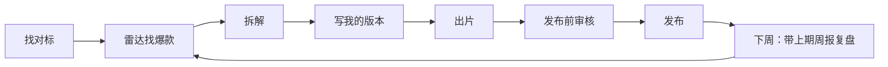

## 五、需要先确认的外部条件（影响录屏）

1. WorkBuddy 有没有浏览器 / computer use 能力：决定 1-1、1-2、2-1 能否实搜。没有就需要 TikHub Key（付费）。
2. 多模态 Key（`VIDEO_ANALYSIS_API_KEY`，推荐 Gemini）：find、diagnostic、crack 都要。
3. 1-1 演示会搜到真实账号：录屏里只展示账号名和公开数据，不展示头像特写；旁白不评价具体账号好坏。
